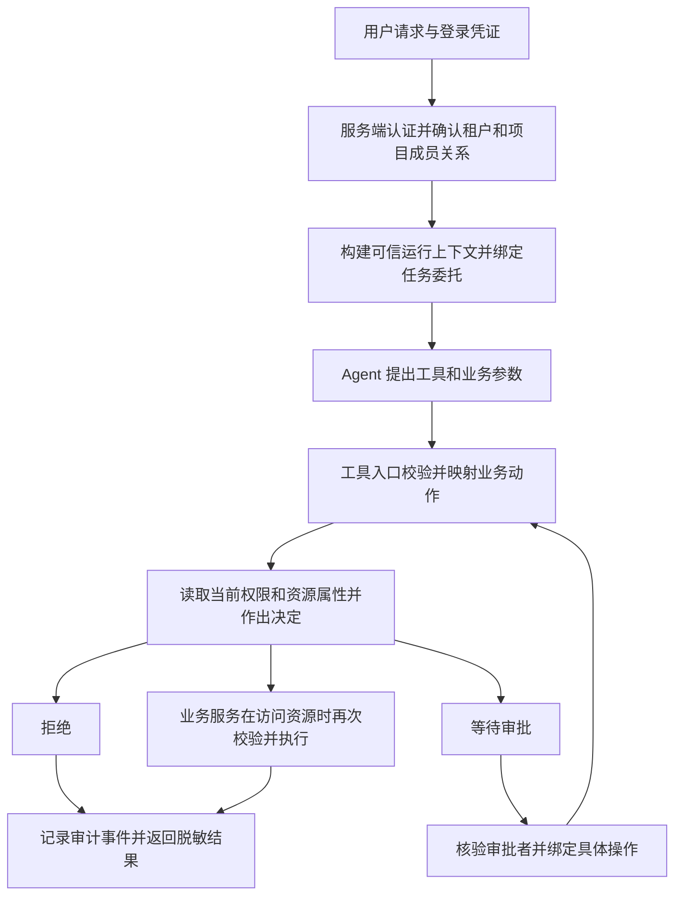

# Agent 操作权限

本目录用于设计和实现 Agent 代表当前用户执行操作时的权限控制。

当前已实现 Python + FastAPI 用户管理服务，包含 21 个接口，以及对应的 Console 后台 UI；后续章节中的 Agent 业务授权仍为架构规划。

用户权限采用可配置 RBAC：用户绑定多个角色，角色绑定操作权限；内置 `admin`、`member` 并支持自定义角色。账号及授权关联支持 Docker PostgreSQL 18 和本地 SQLite 持久化。

- [Docker 数据库与迁移](docs/docker-database.md)：启动独立 PostgreSQL、迁移 SQLite 全量数据及切换后台连接。
- [可配置 RBAC](docs/rbac.md)：数据模型、角色管理接口、授权边界和旧数据库迁移。
- [运行说明](docs/running.md)：环境准备、管理员初始化、启动服务、登录、配置与测试。
- [Console 页面说明](console/README.md)：登录、用户管理、角色与权限、个人设置及前端开发方式。构建后入口为 `/console/`。
- [用户管理服务接口文档](docs/user-management-api.md)：当前阶段的登录、用户管理、改密、角色、错误响应和并发控制契约。
- 本说明后续章节：Agent 业务操作授权的架构规划，其中的租户、项目与文档角色为后续业务示例，与用户管理服务的系统角色区分。

## 1. 使用场景与核心原则

第一版假设：用户登录业务系统后，通过 Agent 读取或修改项目中的资源。Agent 以该用户的身份受托执行，不能因为运行服务持有更高权限的凭据就获得额外业务权限。

模型负责提出操作，例如“读取文档 D1”；服务端负责判断是否允许，并在实际访问资源的位置强制执行。提示词、模型自行声明的身份、页面按钮是否隐藏，都不构成权限依据。

一次操作是否可以执行，必须同时满足：

1. 用户身份有效，仍然拥有该操作所需的当前权限。
2. 操作及资源落在本次任务的委托范围内，委托未过期、未撤销。
3. 当前 Agent 被配置为可执行该动作，子 Agent 还受父级委托范围限制。
4. 当前用户能访问这项具体资源，租户、项目、资源关系及环境约束均满足。
5. 如规则要求审批，存在针对本次具体操作的有效批准记录。

任何显式拒绝优先；未配置的动作和无法完成的校验默认拒绝。默认拒绝、逐次检查及资源级校验参考 [OWASP Authorization Cheat Sheet](https://cheatsheetseries.owasp.org/cheatsheets/Authorization_Cheat_Sheet.html)。

## 2. 身份从哪里来



身份链路：

1. HTTP 入口校验 Session 或身份令牌；采用签名令牌时，还需验证签名、签发方、目标服务和有效期。
2. 从可信用户与成员关系存储中确定 `user_id`、`tenant_id`、`project_id` 和相应范围的角色。客户端可请求切换项目，但服务端必须核验成员关系。
3. 服务端建立运行上下文并创建任务委托。客户端传入的角色、管理员标志和用户 ID 不能覆盖认证结果。
4. 工具从运行上下文取得身份；模型只填写文档 ID、修改内容等业务参数。
5. 恢复执行和每次敏感访问时，重新读取当前权限，不能只依赖任务创建时的角色快照。

本地离线演示可以使用受控测试身份，但必须标明模拟入口，不能将允许随意指定角色的接口作为真实认证入口。

## 3. 数据模型

### 3.1 可信运行上下文 `ExecutionContext`

| 字段 | 含义与来源 |
| --- | --- |
| `subject_user_id` | 被代理的用户；来自服务端认证 |
| `actor_agent_id` | 实际执行的 Agent；来自服务端注册配置 |
| `tenant_id`、`project_id` | 经服务端验证的业务范围 |
| `run_id`、`thread_id` | 服务端生成或完成归属校验的执行与会话标识 |
| `grant_id` | 本次运行绑定的受限委托 |
| `session_id` | 交互会话引用；需要时检查会话有效性 |
| `parent_run_id` | 子 Agent 对父运行的引用，可为空 |
| `request_id` | 请求关联与审计标识 |

角色和权限可按需从服务端加载。上下文本身只是传递机制；其可信性来自创建入口、访问隔离和存储保护。

不把身份字段放进模型可填写的工具参数，不从聊天记录提取身份，不使用进程级全局变量保存“当前用户”。令牌与下游凭据由服务端管理，不写入提示词或普通会话记录。

### 3.2 任务委托 `RunGrant`

保存 `grant_id`、委托用户、租户与项目、目标 Agent、允许动作、允许资源范围、环境限制、失效时间、撤销状态及父委托引用。

委托由可信服务按产品配置和用户明确选择创建；模型不能自行扩大范围。若第一版没有任务范围选择界面，可使用明确配置的默认范围，例如“项目 P1 中允许访问的文档，仅限读取”。

旧任务的可执行范围始终受原委托上限约束。用户新增角色不会自动扩大旧任务的委托；权限收回后，旧任务也不能继续凭旧快照执行。

这里的权限交集是对“动作、资源和条件”的共同约束，不能只对角色名称做集合运算。

### 3.3 授权请求 `AuthorizationRequest`

包括可信上下文、业务动作、服务端加载的资源属性，以及待执行操作的规范化参数。

- 动作由工具注册表映射，例如 `read_document` → `document.read`，模型不能用参数将删除改标为读取。
- 工具入参必须按类型和允许字段校验；不直接透传任意请求体给下游服务。
- `resource_id` 可以来自工具参数，但资源的租户、项目、所有者、ACL 和版本必须由服务端查询。
- 创建操作检查目标项目或父目录；批量操作逐项检查，不能只检查第一条。
- 列表、搜索和知识检索将数据范围约束下推到查询，在内容进入模型前过滤，并在返回资源时核验访问权。
- 返回受限字段时按策略裁剪；允许读文档不等于允许读取凭据或导出全部数据。

### 3.4 授权结果 `AuthorizationDecision`

| 字段 | 含义 |
| --- | --- |
| `effect` | `allow`、`deny` 或 `require_approval` |
| `reason_code` | 稳定原因码，例如 `ACTION_NOT_GRANTED`、`RESOURCE_NOT_ACCESSIBLE` |
| `policy_version` | 用于追踪此次判断所依据的策略版本 |
| `obligations` | 必须执行的字段裁剪、查询范围或审批要求 |

执行入口必须落实所有义务；无法落实就拒绝。模型只接收脱敏后的原因与可行下一步，不能获得隐藏资源名称、ACL 详情或凭据。

## 4. 怎样根据身份判断权限

建议第一版采用“角色权限 + 资源关系 + 环境条件”，先用简单、可测试的 Python 规则实现。

### 4.1 角色决定可执行哪些动作

角色绑定租户或项目，不能因为用户在项目 P1 是管理员，就让其在项目 P2 也拥有管理员权限。

| 示例角色 | 拟议动作权限 |
| --- | --- |
| `viewer` | `document.read` |
| `editor` | `document.read`、`document.update` |
| `project_admin` | 上述动作及 `document.delete` |

角色提供动作权限，具体资源仍需满足下一层检查。第一版不设置隐含的跨租户或私人内容管理员旁路。

### 4.2 资源关系决定能操作哪些对象

对每个文档检查：

- 资源租户、项目与运行范围一致。
- 当前用户是所有者，或通过文档 ACL 获得对应读写访问权。
- 更新、删除还需满足资源当前状态等业务条件。

拥有 `document.update` 只代表具备更新能力，还必须有目标文档的写访问权。所有者关系也不能绕过角色动作权限或 Agent 委托限制。

### 4.3 决策顺序

1. 验证身份、执行归属、委托有效性和 Agent 配置；失败则拒绝。
2. 检查租户、项目、资源访问关系和显式禁止规则；不满足则拒绝。
3. 检查当前用户权限、任务委托、Agent 动作范围是否共同覆盖请求；不满足则拒绝。
4. 判断是否需要审批；需要且尚无有效批准则返回 `require_approval`。
5. 返回 `allow`，由执行层完成义务、最终校验和业务操作。

审批只解决“已有权限的这次操作能否执行”，不会授予用户原本没有的动作或资源权限。如需管理员代操作，应创建单独、可审计的授权流程和执行主体。

## 5. 工具与业务服务的职责

工具入口负责注册校验、参数检查、统一错误反馈和审批暂停。业务服务负责在实际读写资源时完成最终授权，普通页面、Agent、后台任务应调用同一套服务规则。

即使模型已经看到了某个工具，调用时仍然需要校验。按权限过滤工具列表可以改善规划质量，但不替代资源访问授权。

本地数据库写入应将最终授权与写入置于同一事务或使用版本条件，覆盖权限与资源状态并发变化。远程调用应由下游服务再次授权；不能声称前置检查能消除跨服务的所有竞态。

连接外部系统时，优先使用代表用户的受限凭据。必须使用服务账号时，工具网关要验证委托和资源范围，下游仍保留租户及对象授权，不能把服务账号的全部权限直接暴露给 Agent。

第一版不提供任意 Shell 或任意 SQL 工具。后续若引入代码执行，必须额外限制进程、文件系统、网络与凭据访问，使其不能绕过业务服务直接取得数据或修改资源。现有文件工具的路径规则不能自动约束 Shell、HTTP 或数据库操作。

## 6. LangChain / LangGraph 接入方式

采用 `context_schema` 声明服务端运行上下文，调用 Agent 时传入 `context`，工具通过 `ToolRuntime.context` 获取身份引用。这种运行时依赖注入方式见 [LangChain Runtime 文档](https://docs.langchain.com/oss/python/langchain/runtime)。

`ToolRuntime` 对应的 `runtime` 参数不暴露给模型填写，见 [LangChain Tools 文档](https://docs.langchain.com/oss/python/langchain/tools)。这不自动提供认证与授权，仍需本模块的可信入口和策略执行。

拟议调用关系：

```text
认证入口 → ExecutionContext / RunGrant
Agent → 工具入口 → 资源元数据加载 → PolicyService.evaluate
allow → 业务服务最终授权 → 执行 → 审计
deny → 脱敏失败结果 → Agent
require_approval → 持久化审批请求 → 暂停 → 审批校验 → 重新授权
```

审批暂停可以使用框架的 Human-in-the-Loop 与持久化 checkpoint；框架提供暂停和恢复机制，审批者权限及批准范围由本模块校验，参考 [LangChain Human-in-the-loop 文档](https://docs.langchain.com/oss/python/langchain/human-in-the-loop)。

身份与委托的可信记录存于服务端。恢复时重新构造运行上下文，不能把 checkpoint 中的角色快照或 `approved=true` 当作执行凭证。后续如增加模型流式调用，按仓库约定使用 `version="v3"`。

## 7. 审批、子 Agent 与长任务

### 审批

审批记录绑定用户、委托、运行、动作、资源、规范化业务参数摘要、资源版本、过期时间和操作幂等键。审批界面展示实际影响，审批者需具备对应审批权限。

恢复时核验批准记录，并重新检查发起者当前权限、委托及资源状态。参数或关键资源版本变化时重新申请；批准记录不能复用到另一项操作。审批消费与执行状态需要防并发，远程写入使用幂等键避免重复副作用。

### 子 Agent

子 Agent 保留原用户身份，使用自身的 Agent 标识和缩小后的子委托。其可执行范围同时受当前用户权限、父委托、子委托及自身配置限制；不能切换为运行服务的管理员身份。

### 长任务和恢复执行

交互模式按会话生命周期执行；持久后台任务必须在创建时获得独立、有限期且可撤销的任务委托，是否随退出登录失效由产品规则明确指定。无论采用哪种模式，账号禁用、权限收回和委托撤销都要在后续执行检查中生效。

恢复请求者需有该运行的操作权限，但不会自动替换原任务的委托用户。审批者的权限也不会自动成为任务执行权限。

读取历史消息、checkpoint、执行产物、检索结果或缓存，同样检查会话及来源资源的访问权限。缓存隔离不能只依赖问题文本；应考虑租户、项目、访问范围与 ACL 版本，不能把旧的授权结果当作永久许可。

## 8. 示例行为

假设：文档 D1 位于项目 P1，Alice 是 P1 的 `editor` 且拥有 D1 写访问权；Bob 是 P1 的 `viewer`；Carol 是 P1 的 `project_admin` 且拥有 D1 写访问权。三个任务都已获得各自角色动作范围以内的文档委托，Agent 配置覆盖相关动作。删除操作额外需要审批。

| 请求 | 结果 | 原因 |
| --- | --- | --- |
| Alice 更新 D1 | `allow` | 动作、委托和资源关系均满足 |
| Bob 更新 D1 | `deny` | 不具备 `document.update` |
| Alice 删除 D1 | `deny` | 缺少删除权限，不能通过普通审批绕过 |
| Carol 删除 D1 | `require_approval` | 基础授权满足，仍需本次操作批准 |
| 任一用户读取其他租户的 D2 | `deny` | 超出当前租户范围 |
| 模型在参数中声明 `role=project_admin` | 拒绝非法参数 | 角色由服务端确定，不能覆盖 |
| Carol 等待审批时被移除项目权限 | `deny` | 恢复时当前权限已失效 |

## 9. 第一版实现范围与目录建议

当前用户管理服务已按接口契约实现，实际目录如下。后续 Agent 权限模块可通过离线、确定性的演示验证规则与强制执行，再接模型。

```text
agent_permissions/
  README.md             # 模块说明与后续授权设计
  main.py               # FastAPI 应用入口
  api.py                # HTTP 接口和统一响应
  __main__.py           # 本地管理员初始化
  config.py             # 环境变量与默认配置
  database.py           # SQLite schema 和事务
  postgres.py           # PostgreSQL 连接、schema 与事务级写锁
  storage.py            # 两种数据库共享的 SQL 接口
  migrate_postgres.py   # SQLite 全量迁移与校验
  setup_postgres.py     # 生成本地 Docker 数据库配置
  deploy/               # Docker Compose 与配置示例
  models.py             # 用户管理请求、响应与校验
  permissions.py        # 权限目录和角色授权查询
  rbac.py               # 角色定义及多对多关联
  service.py            # 用户、会话、授权、审计与限流
  security.py           # 密码与会话凭据处理
  console_ui.py         # 同源托管 Console 构建产物
  console/              # React、TypeScript、Vite 后台界面与浏览器测试
  test_api.py           # 接口、并发与异常边界测试
  test_console.py       # Console 路由、静态资源与构建缺失检查
  docs/
    user-management-api.md # 用户管理接口契约
    running.md          # 启动、配置和测试说明
```

以下为后续 Agent 业务授权的拟议验收场景，不代表当前用户管理服务已实现 Agent 调用：

- 同一工具、不同用户、不同资源产生预期差异；拒绝时实际业务函数未执行。
- 伪造身份参数、跨租户 ID、未注册工具和权限服务异常均不能放行。
- 角色允许但资源不允许、资源允许但委托不允许，都被拒绝。
- 列表、搜索、批量操作和历史记录不会泄漏其他用户无权访问的内容。
- 等待审批后权限被撤销，恢复执行仍拒绝；批准记录不能换参数或重复使用。
- 子 Agent 权限不超出父任务；同进程并发用户不会串用身份。
- 所有允许、拒绝、待审批和执行失败均留有审计记录，且无令牌或敏感正文。

无需在第一版引入独立策略服务或复杂规则语言，先通过可测试规则和统一业务服务执行边界验证设计。

## 10. 仓库内已有参考

- `../deepAgentsProject/packages/auth/permissions.py`：已有角色到动作的映射，可参考命名与应用边界检查方式。
- `../deepAgentsProject/packages/auth/resource_access.py`：已有资源访问、执行身份刷新与来源访问约束，可参考资源和恢复执行的检查方式。
- `../exec_env/permission.py`：已有内置文件工具的路径规则与人工中断示例，适用范围与业务授权不同。

以上为现有子项目中的参考实现，本模块未接入或改动它们。当前用户管理服务缺失登录身份时拒绝访问，不采用默认 owner 权限；后续 Agent 授权仍需按本文规划实现。
