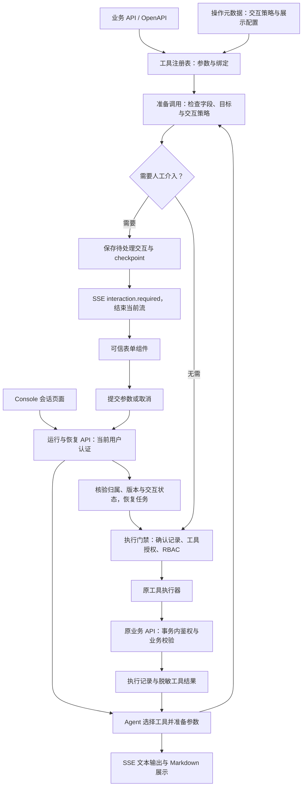
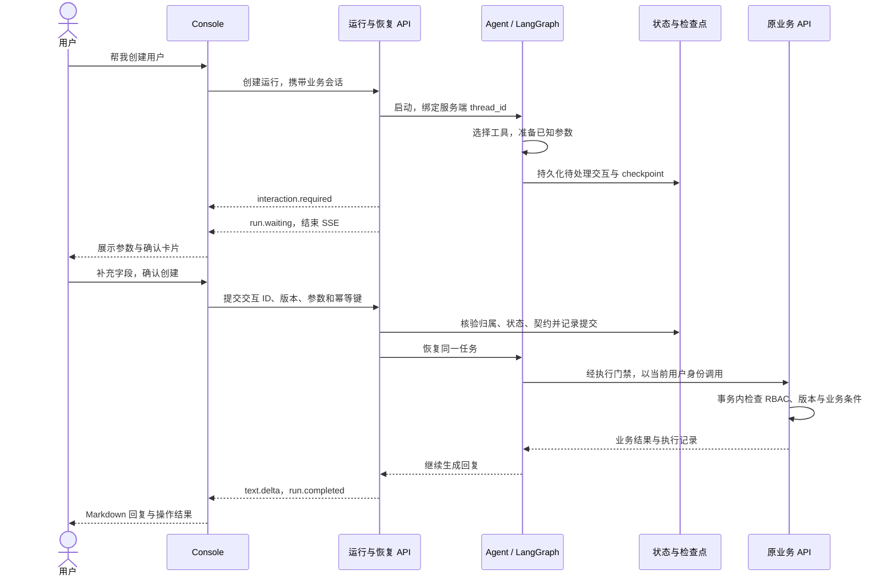
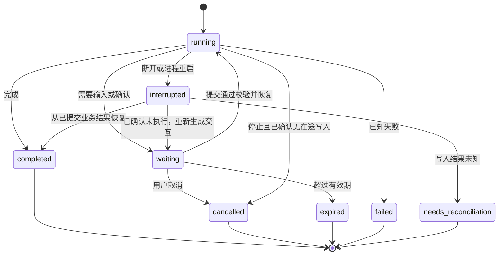

# Agent 工具参数收集与执行确认设计方案

状态：第一版已实现（2026-11-17）。本文保留设计依据与演进边界；实际字段、接口、配置和部署步骤以[交互工具说明](agent-hitl.md)为准。

设计日期：2026-11-17。

关联方案：[API Agent 工具](agent-tools.md)、[用户级 Agent 工具授权](user-agent-tool-grants.md)、[OpenAI 兼容 Chat 接口](chat-api.md)、[Console 页面说明](../console/README.md)。

第一版落地说明：使用自定义顺序 `StateGraph` 与 `interrupt`，没有同时叠加 HITL 中间件。字段展示规则集中在 `hitl_forms.py` 的应用映射，结合注册表 Schema 生成卡片；尚未提供单独的 `ui_schema` 配置文件和逐字段来源追踪。修改展示规则需提升 `formVersion`。当前执行结果在段结束时通过 `tool.completed` 发送，`tool.started` 和外部操作的 `needs_reconciliation` 保留为后续扩展；当前所有启用的写工具均有同库事务回执。原有三重约束（用户授权、当前操作确认、实时 RBAC）完整保留。

## 1. 目标与设计结论

当 Agent 判断需要调用某个业务工具时，先准备调用参数；需要补充信息或人工确认时，暂停任务，在会话页面展示结构化表单。用户提交后，服务端重新校验参数、工具授权和 RBAC，再通过原工具执行链调用业务 API，并继续流式回复。

方案可行，采用“参数准备 + HITL 暂停与恢复 + 动态表单 + 原业务执行链”的架构：

- HITL 负责暂停、持久化和恢复 Agent 执行。
- 动态表单负责展示字段、收集输入和表达本次操作的影响。
- 工具注册表提供参数契约和交互策略，保持接口、工具与表单同步。
- 业务服务继续负责实时 RBAC、资源范围、版本冲突和业务约束。

LangChain 的 `HumanInTheLoopMiddleware` 支持在工具执行前批准、编辑参数或拒绝调用；自定义参数收集可以使用 LangGraph 的 `interrupt()`。[官方 HITL 文档](https://docs.langchain.com/oss/python/langchain/human-in-the-loop)

本方案中的“人工确认”由发起任务的当前用户完成，不引入上级审批人，也不扩大该用户的权限。

## 2. 现状与范围

### 2.1 改造前能力与衔接

| 位置 | 当前能力 | 本次设计的衔接方式 |
| --- | --- | --- |
| [operations.py](../operations.py) | 操作 ID、权限要求、`read/write/destructive` 操作性质 | 补充交互策略与字段展示元数据 |
| [api_tools/compiler.py](../../api_tools/compiler.py) | 从 OpenAPI 生成 `inputSchema` 和 HTTP 绑定 | 继续作为参数约束来源，校验扩展元数据及版本 |
| [tooling.py](../tooling.py) | 用户工具授权检查和调用入口 | 增加需要人工介入时的执行门禁 |
| [api_tools/executor.py](../../api_tools/executor.py) | 参数校验、RBAC 预检、同源 HTTP 调用 | 保留通用职责，不写入应用的 HITL 数据库逻辑 |
| [service.py](../service.py) | 事务内鉴权、业务处理和审计 | 衔接执行记录与必要的写入去重 |
| [chat_api.py](../chat_api.py) | 每次请求创建 Agent，120 秒超时，SSE 文本输出 | 抽取可持久化、可恢复的运行逻辑 |
| [chatHistory.ts](../console/src/chatHistory.ts) | 按账号隔离的浏览器会话历史 | 保存运行引用和卡片摘要，恢复状态以服务端为准 |
| [chatStream.ts](../console/src/chatStream.ts) | 解析文本、用量和结束事件 | 为交互接口增加结构化事件解析 |
| [tracing.py](../tracing.py) | LangSmith 追踪与脱敏 | 关联暂停和恢复，隔离敏感表单值 |

改造前 Chat 没有持久化 checkpointer；现已由 `hitl_runtime.py`、`hitl_checkpoint.py` 和 `hitl_store.py` 提供持久化图、交互及执行记录。浏览器保留运行引用，不保存表单草稿或秘密。

### 2.2 第一版范围

覆盖当前会话内的参数补充、目标选择、参数修改、执行确认、取消、过期和刷新恢复；支持现有 SQLite / PostgreSQL 部署。每次处理一个待执行工具调用，继续使用现有用户身份和业务接口。

第一版不包含多人审批、跨用户代审批、批量一键确认、任意模型生成页面、通用工作流编排器，以及完整的云端会话历史产品。

## 3. 交互策略

### 3.1 触发规则

| 场景 | 默认处理 | 页面行为 |
| --- | --- | --- |
| 读取工具，参数完整且目标明确 | 直接执行 | 显示结果 |
| 缺少必填业务字段 | 暂停补参 | 预填已知信息，标记待填写字段 |
| 目标有歧义，例如多个同名用户 | 暂停选择 | 展示有权限查看的候选对象 |
| 写入工具 | 执行前确认 | 展示最终参数，允许按规则修改 |
| 删除、改密等 `destructive` 工具 | 执行前明确确认 | 展示具体对象、影响和明确的执行按钮 |
| 参数来自当前身份或可信执行上下文 | 服务端提供 | 不要求用户填写身份令牌等技术字段 |
| 未授权、缺少 RBAC 或工具已下线 | 拒绝进入执行流程 | 解释不可执行原因，不展示可提交的执行表单 |

写操作需要补参时，在一张卡片中完成填写和确认，主按钮为“确认创建”“确认修改”等具体动作。只读补参可以使用“提交并查询”。用户已经明确提供且无需修改的字段应预填，避免重复输入。

### 3.2 策略归属

在应用操作元数据中声明 `interaction_policy`，初始支持：

| 策略 | 行为 |
| --- | --- |
| `when_needed` | 缺少参数、目标不明确或存在必须人工填写的字段时暂停 |
| `always_confirm` | 参数完整时仍要求用户确认；缺参时合并到补参卡片 |

默认 `read` 使用 `when_needed`，`write/destructive` 使用 `always_confirm`。读取工具可以显式提高为始终确认；第一版不提供关闭写操作确认的普通用户开关。新增工具按操作性质获得默认策略，新增用户工具授权仍遵守默认不允许的既有规则。

交互策略属于操作定义，用户工具授权继续只表示该用户是否委托 Agent 使用工具，不往授权表中混入本次确认状态。

## 4. 总体架构



表单提交由后端恢复任务并执行工具，浏览器不直接拼接业务 URL 发起 Agent 操作。普通业务页面继续直接调用原业务 API，并遵守原有 RBAC。

## 5. 参数准备与动态表单

### 5.1 分开处理准备参数与执行参数

用户说“帮我创建用户”时，可以确定工具，但尚不能形成合法的创建参数。需要允许“工具已选定、参数未齐全”的中间状态，不能要求模型为形成完整调用而猜测用户名、密码或角色。

设计两条入口，统一进入准备阶段：

1. 模型已给出完整业务工具调用：执行前拦截，按策略直接执行或转为确认卡片。
2. 模型已识别工具但缺少信息：通过应用内部的补参动作提交 `operation_id + 已知参数`，由服务端生成待处理交互。

补参动作仅负责提出草案和触发暂停，不调用业务 API；它不由公开业务路由生成，也不接受任意 URL、身份或执行标志。操作 ID 必须属于当前用户可使用的工具目录，已提供字段必须按注册表校验。

准备阶段允许字段缺失；最终执行仍按原始完整 `inputSchema` 校验。保留“未提供”“明确传 null”“空字符串”和“保持原值”的区别，尤其不能把更新表单的所有空项自动提交为 null。

预填值记录来源：用户明确输入、已授权查询结果、接口默认值或模型建议。无法确认的关键值交给用户核对；密码等人工输入字段不允许模型代填。单靠 Schema 检查不能证明模型建议符合用户意图。

### 5.2 表单描述来源

| 信息 | 来源 |
| --- | --- |
| 类型、必填、枚举、长度、范围、嵌套结构 | 已生成工具的 `inputSchema` |
| 中文名称、说明、排序、组件类型 | 操作的 `ui_schema` 展示配置 |
| 允许修改的字段、敏感字段、人工填写要求 | 服务端字段策略 |
| 用户或角色等动态选项 | 具备明确绑定的业务查询，使用当前身份 |
| 当前值、缺失字段、冲突说明 | 本次交互记录及最新校验结果 |

`ui_schema` 通过 JSON Pointer 引用原参数字段，例如 `/body/display_name`，不能创建 Schema 中不存在的业务参数，也不能放宽业务约束。前端将控件映射回原 `path/query/header/body` 结构，普通用户看到业务字段名称。

第一版组件覆盖文本、数字、布尔、枚举、枚举多选、受控对象选择和密码输入；角色等动态选项使用后端白名单适配器，不接受模型指定的远程地址。只读查询也要遵守对应权限，无法加载选项时显示失败或不可用，不能换用管理员身份读取。

`Authorization`、请求标识来自运行上下文；`If-Match` 等版本条件由服务端按工具专用准备规则获取并绑定到用户看到的目标快照，不作为自由输入项。目标查询必须使用用户已有权限，不额外增加查询权限。

无法安全渲染的复杂 Schema 应返回明确的不支持状态，停止该操作。实现期列出支持的 Schema 子集，并在工具构建时验证展示配置；不可静默丢弃字段或直接放行。

### 5.3 自动同步

- 工具注册表继续由业务 API 契约生成；表单约束复用同一份 Schema。
- 展示配置和交互策略纳入确定性的版本计算；策略变化也会使旧确认失效。
- 第一版绑定整个工具包的 `bundleDigest`，目录发生变化时要求重新准备，接受无关接口变化也可能使旧卡片失效的保守行为。
- 工具删除后，旧交互不可执行；工具参数或策略变化后，旧表单标记失效并重新生成，不能自动套用旧确认。
- 用户授权变更不改变工具包摘要，仍在调用时独立检查。

## 6. 暂停、恢复与状态

### 6.1 运行方式

采用 LangGraph 持久化 checkpoint 和服务端生成的 `thread_id`，恢复时使用同一线程的 `Command(resume=...)`。生产部署使用与数据库部署适配的持久化后端，内存 checkpointer 仅用于离线测试。[LangGraph Interrupts 官方文档](https://docs.langchain.com/oss/python/langgraph/interrupts)

第一版采用请求驱动执行：创建或恢复请求只在 Agent 实际运行期间保持 SSE；遇到等待状态，先保存交互与 checkpoint，再发送事件并结束流，不占用 HTTP 请求、数据库事务或连接等待用户。无需为第一版引入独立消息队列。

每个运行使用独立 `thread_id`，每次新消息形成一个运行；一个浏览器会话同时最多有一个未结束运行。不能用客户端会话 ID 直接选择任意 checkpoint。服务端校验 `user_id + run_id` 归属后才加载内部线程。

活跃运行通过数据库状态比较和短期执行租约防止多个请求或进程同时恢复；租约只覆盖实际计算，等待期间不持有连接或事务。取消请求写入可跨进程读取的停止标记，停止后续调度；租约失效的活跃运行进入故障核对流程。

继续使用 `version="v3"` 的 Agent / LangGraph 流式 API，单独识别中断结果；等待输入是正常状态，不应触发当前“最后一条消息仍带 tool_calls 就判定失败”的分支。

现有环境核对版本为 LangChain 1.3.18、LangGraph 1.2.11。方案不依赖新版中间件的 `interrupt_mode="per_call"`；实现时可使用自定义准备与调度节点串行处理，不盲目照搬新版示例参数。

### 6.2 交互时序



### 6.3 状态模型

运行状态与交互状态分开保存：

| 对象 | 状态 | 含义 |
| --- | --- | --- |
| 运行 | `running` | 正在规划、执行或生成回复 |
| 运行 | `waiting` | 已挂起，有待处理交互 |
| 运行 | `completed` | 任务正常结束 |
| 运行 | `cancelled / expired / failed` | 已取消、已过期或已知失败 |
| 运行 | `interrupted` | 活跃执行被断开或重启打断，需读取执行记录后处理 |
| 运行 | `needs_reconciliation` | 某次写入结果未知，必须先核对，禁止自动重放 |
| 交互 | `pending` | 等待填写或确认 |
| 交互 | `submitted` | 提交已接受，正在推进恢复 |
| 交互 | `consumed` | 本次决策已用于对应调用，不能再次使用 |
| 交互 | `cancelled / expired / invalidated` | 用户取消、过期或工具契约等条件变化使其失效 |

交互另有 `kind=collect_parameters/confirm_action`。需要补参的写操作使用 `collect_parameters`，同时设置 `confirmation_required=true`，一次提交即可表达填写与确认。



用户取消待处理卡片时，第一版结束当前运行，不让模型自动重试相同操作。取消不能回滚此前已完成的业务操作；若已有执行结果，页面仍展示该结果。

同轮出现多个工具调用时按稳定顺序排队，逐项处理；一张卡片只确认一项调用。恢复必须使用原 `tool_call_id` 关联工具结果，不能重发用户原话重新规划整个任务。

## 7. 持久化与敏感数据

### 7.1 应用实体

下列是逻辑表设计，物理字段和索引在实现时随数据库迁移落实：

| 实体 | 关键字段 | 用途 |
| --- | --- | --- |
| `agent_chat_runs` | `id`、`user_id`、`client_conversation_id`、`client_request_id`、`thread_id`、`graph_version`、`status`、`version`、执行租约、停止标记、`expires_at`、时间戳 | 归属、幂等创建、状态与内部线程映射 |
| `agent_interactions` | `id`、`run_id`、`tool_call_id`、`operation_id`、`catalog_revision`、`kind`、`draft_arguments`、`field_policy`、`target_snapshot`、`version`、`status`、`expires_at` | 待处理参数和本次确认范围 |
| `agent_tool_executions` | `id`、`run_id`、`interaction_id`、`tool_call_id`、`submission_id`、`arguments_digest`、`status`、`result`、`error_code`、时间戳 | 去重、执行结果和故障核对；自动读取调用的交互 ID 可为空 |
| 框架 checkpoint 表 | 线程、节点状态、必要消息及工具结果 | 恢复图执行，使用框架适配器管理 |

`draft_arguments`、`target_snapshot` 和执行结果只存必要字段；敏感值按下述规则处理。应用记录与 checkpoint 有独立写入边界时，以持久化提交和执行记录核对推进状态，不能假设两者天然处于同一事务。

服务端为创建请求建立 `(user_id, client_request_id)` 唯一约束；为提交建立 `(interaction_id, submission_id)` 唯一约束，并对待处理交互做版本比较和原子状态转换。执行去重使用稳定的运行内调用标识，不能只凭按钮禁用。

### 7.2 数据边界与生命周期

- 浏览器继续保存按账号隔离的展示历史，新增运行引用和非敏感卡片摘要；本地状态不构成执行依据。
- 服务端新增恢复所需的任务上下文和 checkpoint，不开展完整的云端会话历史迁移；需要保存的消息属于本次运行的恢复数据。
- 实现默认：待处理交互有效期 30 分钟，运行最长存续 24 小时；每次活跃执行段沿用 120 秒限制，等待不计入活跃超时。图步骤额度按整次运行累计，不能通过反复恢复绕过限制。
- 实现默认：终态运行的消息、checkpoint 和表单草案在 24 小时后清理；脱敏执行去重记录保留 30 天，并返回已清理状态，不能因记录清理重新执行旧提交。审计保留策略沿用应用规定。
- 取消、过期或终态清理都不能删除已有业务数据；清理任务需覆盖 SQLite / PostgreSQL 与 checkpoint 存储。

上述时长为本设计的初始建议值，应作为服务端配置统一管理，不视为已经生效的产品行为。

### 7.3 密码与身份

敏感字段由人工表单收集，单独放在请求的 `sensitive_values` 中；服务端合并到即将执行的参数时不改变原 API 契约。明文只存在于当前受控执行上下文，不进入模型消息、普通 checkpoint、`localStorage`、SSE 回显、审计详情或 LangSmith 输入。

图状态只保存本次敏感值的临时引用；恢复请求内注入实际值，失败或重启后需要重新填写，不能把密码占位符作为实际参数执行。记录摘要时对敏感部分使用受服务端密钥保护的摘要，避免保存可离线枚举的普通密码哈希。

会话令牌不存入 checkpoint，恢复请求重新认证并构造身份。退出、改密、禁用自己等操作可能使当前会话失效：记录业务成功事实并提示重新登录，不能把后续模型或鉴权失败等同于业务未执行。

## 8. 执行约束、权限与幂等

一次工具调用通过以下条件后才可进入原业务服务：

```text
当前身份有效 + 运行归属正确 + 工具与版本有效
+ 用户允许 Agent 使用该工具 + 当前 RBAC 满足
+ 最终参数合法 + 本次交互要求已满足
→ 原业务 API 的资源、版本及事务内权限检查
```

准备表单前和恢复执行前都检查调用资格。用户提交期间角色或授权被撤销，恢复应拒绝；保留原用户工具授权设置，不能自动删除。确认只授权当前参数对应的一次操作，不授予持续权限。

公共 `/agent-tools/call` 也执行相同交互策略：遇到必须确认的调用而没有有效的服务端确认记录，返回 `409 INTERACTION_REQUIRED`，不能继续调用业务 API。已授权且无需交互的读取维持原行为；原业务页面的 HTTP 操作仍按原有权限规则处理。

恢复流程通过可信运行上下文传递执行凭据，该凭据绑定用户、工具、参数摘要、目标版本及本次执行记录。它不进入模型可填写参数，客户端不能用 `approved=true` 或替换工具名称绕过门禁。

提交与执行按以下原则落实：

1. 先验证身份、归属、有效期、交互版本和字段白名单；客户端不能更换工具、执行主体或隐藏目标。
2. 最终参数与服务端隐藏字段合并后，再按完整 Schema 和操作特定规则校验。
3. 目标 ETag 已变化时返回冲突；不能自动刷新 ETag 后继续执行用户尚未确认的新状态。
4. 原子接受一个有效提交并绑定唯一执行记录。相同提交重试返回已接受状态或结果，不启动第二份业务执行；相同幂等键携带不同参数应拒绝。
5. 当前本地写操作需将业务变更与执行成功记录放在同一业务数据库事务中；经可信上下文把执行 ID 传入业务层，复用其事务内 RBAC。单独在 HTTP 调用前后写标记无法保证故障后的写入去重。
6. 原有操作元数据中的 `idempotent` 不能替代实际去重；尚未具备执行记录保障的写工具不进入上线覆盖范围。
7. 对远程或无法同事务落地的未来工具，使用下游幂等键或结果查询；无法确定结果时标为 `needs_reconciliation`，禁止自动重放，不承诺任意外部系统上的严格一次执行。

LangGraph 恢复时可能重新执行所在节点，因此实际写入应放在确认之后并配合业务去重，确认之前不执行不可重复的副作用。[官方中断与副作用说明](https://docs.langchain.com/oss/python/langgraph/interrupts#side-effects-called-before-interrupt-must-be-idempotent)

## 9. 运行 API 与 SSE 契约

以下为控制协议设计；第一版正式契约及当前发送事件见[实现说明](agent-hitl.md#运行-api)。所有控制接口使用当前业务 Bearer 会话、归属校验和 `Cache-Control: no-store`，声明 `x-agent.expose=false`，不生成业务工具。

### 9.1 接口列表

| 方法 | 路径 | 用途与响应 |
| --- | --- | --- |
| POST | `/api/v1/chat/runs` | 创建并执行运行，返回 SSE；支持 `client_request_id` 幂等 |
| GET | `/api/v1/chat/runs?conversation_id=...` | 查询当前用户该浏览器会话的有效运行引用，处理丢失首个 SSE 事件等情况 |
| GET | `/api/v1/chat/runs/{run_id}` | 返回状态、非敏感输出、用量和当前待处理交互 |
| POST | `/api/v1/chat/runs/{run_id}/interactions/{interaction_id}/refresh` | 显式重新准备尚未执行的操作，失效旧卡片并返回新卡片；不执行业务写入 |
| POST | `/api/v1/chat/runs/{run_id}/interactions/{interaction_id}/resume` | 提交本次参数和决策，验证后返回恢复执行的 SSE |
| POST | `/api/v1/chat/runs/{run_id}/recover` | 从持久化图主动恢复中断或失败的任务，不重新发送原任务 |
| POST | `/api/v1/chat/runs/{run_id}/cancel` | 取消等待，或请求停止活跃运行；返回当前状态，不能承诺回滚 |

创建请求包含现有模型与消息参数，以及 `client_request_id`、`conversation_id`；身份不由请求体指定。`conversation_id` 只用于当前用户范围的索引，不允许用于读取其他用户的数据。

提交示例，以修改用户展示名称为例，原 `path.user_id` 和 `header.If-Match` 由服务端绑定：

```json
{
  "submission_id": "sub_example_01",
  "expected_version": 1,
  "decision": "submit",
  "values": {
    "/body/display_name": "张三"
  },
  "sensitive_values": {}
}
```

`values` 只包含允许用户填写的字段，映射规则明确区分缺省与 null。`decision=cancel` 不允许附带参数。写操作的 `submit` 表示对页面展示的最终参数确认执行；只读补参的 `submit` 表示提交并查询。

参数错误在恢复图之前返回 `422` 和安全的字段错误，保持交互可编辑。提交成功后，首个事件确认接受状态；相同提交重试返回状态快照及流结束事件，不重复执行。创建请求重试遵守相同规则。

`refresh` 同样携带幂等请求标识与期望交互版本，先检查归属、运行状态及执行记录，仅为确认未执行的这一操作重新读取目标和生成卡片。新卡片重新绑定契约及目标版本，只保留仍合法的非敏感草稿，不继承批准状态。工具已下线或运行所用图版本无法兼容恢复时明确拒绝并结束该待执行操作；不能通过重新发送整段原始任务来重复已经执行的步骤。

### 9.2 事件格式

扩展接口使用命名 SSE 事件，与标准 Chat Completions 流分开解析。所有事件携带 `protocol_version`、`run_id`、`stream_id`、流内递增 `sequence`，不携带明文密码和会话凭据。

| 事件 | 含义 |
| --- | --- |
| `run.started / run.resumed` | 运行创建或恢复已接受 |
| `run.snapshot` | 重试或状态对齐时返回已有结果 |
| `text.delta` | 当前助手消息的 Markdown 增量，携带稳定 `message_id` |
| `interaction.required` | 返回交互 ID、版本、种类、工具业务名称、可渲染字段及非敏感草稿 |
| `run.waiting` | 运行已持久化挂起，客户端可安全结束当前流 |
| `tool.started / tool.completed` | 工具状态与脱敏执行结果，用于区分业务成功和回复失败 |
| `usage.updated` | 有依据的本次运行累计用量，客户端替换累计值，不重复相加 |
| `run.completed / run.cancelled / run.expired / run.failed` | 运行终态 |
| `run.interrupted / run.needs_reconciliation` | 需要恢复状态或核对执行结果 |
| `stream.closed` | 当前传输结束，携带运行状态；不表示运行一定完成 |

`interaction.required` 发出之前，交互记录和可恢复 checkpoint 必须已经可用。文本累计快照作为恢复依据；第一版不提供逐事件重放，重连时 GET 运行状态并按消息 ID 替换快照，不能仅凭 `sequence` 声称可从任意 token 续传。

SSE 开始前的错误使用 HTTP 状态与项目错误格式；开始后的错误使用明确的运行事件。等待不算错误，异常断流也不算成功。用户填表期间不保持 SSE 连接。

### 9.3 错误约定

| HTTP 状态 | 原因码 | 处理 |
| --- | --- | --- |
| 401 | `UNAUTHENTICATED` | 重新登录，以同一用户身份读取任务 |
| 403 | `TOOL_NOT_GRANTED / PERMISSION_DENIED` | 显示权限变化，停止执行 |
| 404 | `RUN_NOT_FOUND / INTERACTION_NOT_FOUND` | 不存在或不属于当前用户，避免泄露他人任务 |
| 409 | `INTERACTION_REQUIRED / TOOL_VERSION_MISMATCH` | 补充交互或重新准备工具调用 |
| 409 | `INTERACTION_ALREADY_RESOLVED / IDEMPOTENCY_CONFLICT` | 读取最新状态，拒绝覆盖已接受提交 |
| 410 | `INTERACTION_EXPIRED` | 旧交互不可恢复，可由用户主动重新发起 |
| 412 | `INTERACTION_VERSION_CONFLICT / RESOURCE_VERSION_CONFLICT` | 保留本地非敏感草稿，重新加载后确认 |
| 422 | `VALIDATION_ERROR / INTERACTION_UNSUPPORTED_SCHEMA` | 显示字段错误或明确的不支持状态 |

上述新增原因码属于本方案。原业务 API 的错误由执行层保留原因并映射到卡片状态，不能将全部失败归为“模型错误”。

## 10. OpenAI 兼容接口

保留 `/v1/chat/completions` 的标准响应与文本流格式；Console 新的结构化交互走扩展运行 API。模型供应商仍使用当前项目内的 Responses API 配置。

两类入口共享运行和工具执行策略。标准 SDK 请求遇到 HITL 时，持久化待处理状态，并返回服务端生成的普通助手文本，说明任务尚未执行以及可在 Console 处理的运行引用。文本回复可以正常结束，但不能宣称业务操作已经完成。

使用标准 SDK 的调用方若要继续，需要接入扩展状态与恢复 API；纯标准客户端可以继续普通对话和不需要交互的读取。原来自动执行的写工具将转为待确认，这是预期行为变化，需在实施时更新兼容接口文档与测试。不得因客户端不支持表单就忽略确认策略。

## 11. Console 交互

会话消息由文本块和工具交互卡片组成。文本沿用现有 Markdown 渲染；表单由受控 React 组件渲染，不解析模型生成的 HTML、脚本或表单 Markdown。

卡片展示业务操作名称、目标对象、影响说明、参数字段、明确按钮和当前状态。技术 ID、内部路径及契约摘要不进入默认用户流程。

| 页面状态 | 行为 |
| --- | --- |
| 等待填写或确认 | 展示可编辑字段和取消按钮，聚焦首个缺失字段 |
| 提交中 | 防止重复提交，保留当前输入 |
| 字段校验失败 | 定位对应字段，保留非敏感草稿 |
| 权限或版本变化 | 展示原因，旧确认不可继续，提供重新读取或重新准备 |
| 已执行 | 卡片只读，展示真实业务结果 |
| 已取消、过期、失效 | 明确不可继续；重新发起必须产生新的操作 |
| 断流或状态未知 | 先读取服务端运行状态，必要时提示核对；不自动重放原消息 |

刷新、切换会话后按运行 ID 读取最新状态；不能根据本地缓存重新启用已消费的表单。账号退出或切换时取消请求，旧账号响应不得写入新账号页面，敏感字段立即清空。

第一版等待状态下不接受同会话的新任务隐式替代当前操作；用户先处理或取消当前卡片，也可以新建会话。支持键盘操作、字段标签、错误关联、窄屏布局及减少动态效果设置。

“停止生成”与“取消待执行操作”按当前状态呈现。活跃请求断开时停止继续调度，但已经进入业务事务的操作可能成功，依据执行记录显示结果。

## 12. 追踪与故障处理

应用审计记录 `run_id`、`interaction_id`、`tool_call_id`、`execution_id`、操作者、操作 ID、版本和结果；参数采用字段级脱敏。LangSmith 的暂停与恢复可以是不同请求的 trace，通过同一 `run_id` 关联，避免长时间保持未结束 trace。

- 用户等待期间服务重启：通过持久化交互和 checkpoint 恢复；需重新认证，不保存旧请求的令牌。
- 活跃执行期间服务重启：先检查执行记录与图状态，确认未执行才允许重新准备；不能自动重放写调用。
- 写入成功后模型回复失败：卡片仍显示操作成功，保留业务执行记录；失败只影响后续回复。
- 提交已记录但 checkpoint 未推进：使用原提交和执行 ID 对齐状态，不生成新的调用 ID。
- 工具下线、策略更新或目标版本变化：原交互失效，重新准备并重新确认。
- LangSmith 不可用：沿用现有可选追踪行为；业务审计和执行门禁不依赖追踪服务。

## 13. 实施顺序

| 阶段 | 工作 | 完成条件 |
| --- | --- | --- |
| 1. 契约与状态 | 操作交互策略、字段元数据、Schema 支持范围、运行及交互表、checkpoint 生命周期 | SQLite / PostgreSQL 迁移、归属隔离和状态查询可验证 |
| 2. 参数准备与门禁 | 补参动作、完整调用拦截、工具入口策略、参数和版本校验、写执行去重 | 缺参不执行、未确认写入不执行、重复提交不重复写入 |
| 3. 运行与恢复 API | 创建、挂起、读取、恢复、取消及扩展 SSE | 等待不占用请求，刷新与重启后可恢复 |
| 4. Console | 卡片渲染、字段组件、提交错误、状态恢复及 Markdown 并存 | 用户可完成填参、确认、取消全流程 |
| 5. 回归与上线 | SDK 行为说明、追踪脱敏、旧工具契约回归、迁移和运行文档 | 下列验收通过后再启用新执行策略 |

后端建议在 `agent_permissions` 内新增运行服务、交互服务和模型适配模块；前端新增独立交互卡片和表单组件，避免把所有逻辑继续堆入 `chat_api.py` 或 `ChatPage.tsx`。公共 `api_tools` 只增加必要的通用元数据或可信上下文支持。

实施期使用根目录共享 `uv` 环境管理 checkpoint 等依赖，不创建嵌套 Python 环境。数据库从当前 schema 3 增量迁移，最终版本按实施时仓库状态确定；不重建用户或清空已保存的工具授权。

## 14. 验收标准

以下为待实施的验收清单，不代表本次文档整理已执行功能测试。

| 编号 | 场景 | 预期 |
| --- | --- | --- |
| H01 | 查询参数完整 | 无多余表单，按原权限执行 |
| H02 | 创建用户缺少参数 | 展示字段，模型不猜测必填敏感值，提交前无业务写入 |
| H03 | 写操作参数完整 | 仍展示最终参数，明确确认后执行 |
| H04 | 必填、枚举、格式、null 与字段省略 | 前端提示，后端执行前独立校验，更新语义正确 |
| H05 | 目标用户重名或角色选项受限 | 只能选择当前身份有权查看的真实候选项 |
| H06 | 取消、过期 | 待执行操作不发生，不能复用旧确认 |
| H07 | 刷新、等待期间服务重启 | 同账号恢复同一交互，其他账号无法读取或提交 |
| H08 | 双击、重复请求、多标签页 | 一次有效提交，最多一份业务写入，冲突可解释 |
| H09 | 等待期间撤销工具授权或 RBAC | 提交被拒绝，授权设置按原规则保留 |
| H10 | 工具参数、交互策略或目录版本变化 | 旧卡片失效，不套用旧确认执行新契约 |
| H11 | 目标 ETag 变化 | 显示冲突，不自动获取新版本继续写入 |
| H12 | 篡改工具名、用户 ID、隐藏字段或确认标志 | 服务端拒绝，无法跨运行或跨用户复用批准 |
| H13 | 直接调用 `/agent-tools/call` 绕过页面 | 缺少有效确认的写调用被门禁拦截 |
| H14 | 写入成功后断流、进程中断或模型回复失败 | 根据执行记录恢复，业务成功不被重放；未知结果需核对 |
| H15 | 一轮多个工具调用 | 串行处理，每项写调用对应独立确认，不默认批准其他项 |
| H16 | 表单密码输入与追踪 | 表单收集的密码不出现在模型消息、普通 checkpoint、浏览器存储、SSE 和 LangSmith 中 |
| H17 | SSE 拆包、中文、重复快照及 Markdown | 正确解析并恢复，不重复文本或累计 token |
| H18 | 标准 OpenAI SDK | 普通聊天与读取兼容，遇到 HITL 返回真实的待处理提示 |
| H19 | SQLite / PostgreSQL、迁移失败 | 行为一致，迁移可回滚，已有用户与工具授权保留 |
| H20 | 移动端、键盘、错误重试和账号切换 | 操作可达、错误可定位、无旧请求污染新账号 |

后端使用受控模型和临时数据库覆盖状态与执行边界；浏览器使用真实服务和假模型完成 Playwright 流程；数据库并发与故障点测试使用隔离的 PostgreSQL schema。验证不依赖真实供应商付费调用。
