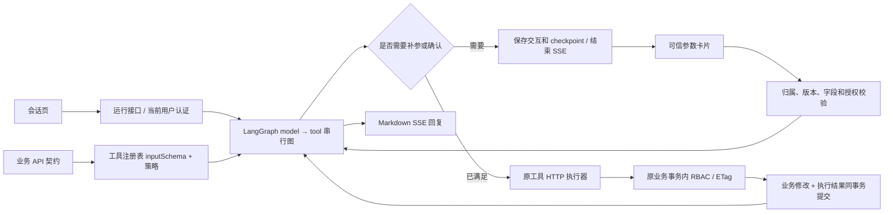

# Agent 交互工具使用与接口说明

实现日期：2026-11-17。设计依据：[HITL 设计方案](agent-hitl-design.md)。

会话页已经支持工具参数填写、执行确认、取消和暂停恢复。参数完整的读取工具自动执行；写入、删除、改密等操作必须先由当前用户确认。原用户级工具授权和业务 RBAC 继续独立生效，确认不会授予新的业务权限。

## 在 Console 中使用

1. 在“用户管理 → 目标用户的更多操作 → Agent 工具授权”中，为需要使用 Agent 的账号开启所需工具并保存。授权配置遵守原有查看、管理权限。会话页展示当前账号可用业务工具数量和状态，返回会话页后会重新读取，也可手动刷新工具状态。
2. 打开 `/console/#chat`，例如输入“创建一个用户”或“创建一个角色”。Agent 可以调用内部 `request_tool_input` 补参动作；即便模型直接发出完整写工具调用，后端也会暂停。
3. 在会话卡片中填写或修改参数。选填字段的“填写此项”区分不提交、空字符串、空数组和明确清空；密码只在表单中填写。目标用户可搜索，角色和权限选项来自当前身份可访问的业务接口。
4. 点击“确认执行”（读取补参为“提交并查询”），服务端重新校验并恢复同一任务。选择了新的写操作对象时，先显示该对象的最新资料，再进行一次确认。
5. 等待期间可以刷新或离开会话；返回后读取服务端状态恢复卡片。点击“取消操作”会终止待办。断流后先“读取最新任务状态”，需要时主动“恢复此任务”；不会自动重新发送整段任务。

等待填写时关闭 SSE，不占着 HTTP 请求或数据库连接。会话只能有一个运行中或待确认的任务，可以新建会话继续其他工作。删除本地会话会取消它的待处理任务；已完成的业务变更仍然保留。

聊天文本和草稿仍按账号保存在浏览器。服务端只保存任务恢复需要的上下文、交互记录和执行记录。浏览器保存 `runId`，不持久化卡片草稿、密码或批准凭据。刷新会丢弃尚未提交的表单编辑和密码，恢复服务端已保存的非敏感参数。

没有可用工具时，服务端不提供 `request_tool_input`，模型只能普通聊天并说明缺少授权。助手的“我来发起表单”这类文字不等于真实工具调用；表单以服务端持久化的交互记录为准。角色业务权限和用户 Agent 工具授权是两项独立条件，管理员账号也需要显式开启工具。

## 执行结构



实现使用 `StateGraph`、持久化 `interrupt()` 与 `Command(resume=...)`，流版本为 `v3`。一轮多个工具按顺序执行，每个写调用分别确认。新增写工具除了声明操作元数据，还必须在业务事务内接入执行记录；未接入会返回 `TOOL_RECEIPT_REQUIRED`，避免错误承诺去重。

`hitl_forms.py` 从注册表 Schema 生成字段。当前支持对象嵌套、标量、可空单分支 `anyOf`、字符串数组与枚举；不支持任意字典、对象数组、多分支联合或模型自定义 UI。中文标签、敏感字段和选项来源由应用白名单映射；修改这些语义时需同步提升 `operations.py` 的 `formVersion`。工具输入 Schema、交互策略和表单版本均由工具包摘要保护。

## 运行 API

所有路径使用业务 `Authorization: Bearer <session_token>`，只允许任务本人访问。响应不缓存；控制路由不生成业务工具。

| 方法 | 路径 | 响应 |
| --- | --- | --- |
| POST | `/api/v1/chat/runs` | 创建并执行，命名 SSE |
| GET | `/api/v1/chat/runs?conversation_id=...` | 该用户该会话最近 20 个未清理任务 |
| GET | `/api/v1/chat/runs/{run_id}` | 当前完整状态快照 |
| POST | `/api/v1/chat/runs/{run_id}/cancel` | 取消等待或阻止后续执行，返回快照 |
| POST | `/api/v1/chat/runs/{run_id}/recover` | 主动恢复被打断或失败的图，返回 SSE |
| GET | `/api/v1/chat/runs/{run_id}/interactions/{interaction_id}/options?field=...&q=...` | 字段候选项，使用原业务权限查询 |
| POST | `/api/v1/chat/runs/{run_id}/interactions/{interaction_id}/refresh` | 重新读取目标或工具版本，返回新的待确认卡片 |
| POST | `/api/v1/chat/runs/{run_id}/interactions/{interaction_id}/resume` | 提交当前卡片，恢复同一图，返回 SSE |

创建请求（`model` 使用 `/v1/models` 返回的值）：

```json
{
  "model": "your-configured-model",
  "conversation_id": "conversation-01",
  "client_request_id": "assistant-message-01",
  "messages": [{"role": "user", "content": "创建一个角色"}]
}
```

相同账号的 `client_request_id` 绑定完整请求，相同内容重试只返回快照，不重新调用模型；换内容复用标识返回 `409 IDEMPOTENCY_CONFLICT`。新运行 API 始终返回 SSE，`stream` 如提供必须为 `true`。

参数提交使用 JSON Pointer，不能携带工具名称、目标身份、URL 或确认绕过标志：

```json
{
  "submission_id": "submit-01",
  "expected_version": 1,
  "decision": "submit",
  "values": {"/body/code": "auditor", "/body/display_name": "审计员"},
  "sensitive_values": {},
  "omit": ["/body/description", "/body/permissions"]
}
```

`values` 与 `sensitive_values` 必须使用对应字段通道。`omit` 只可省略可编辑选填字段；必填或绑定的目标、身份、版本字段不能省略或篡改。`decision=cancel` 不接受字段内容。刷新卡片请求是 `{"request_id":"refresh-01","expected_version":1}`，也支持幂等重试。

HTTP `422` 字段错误在图恢复前返回，保持卡片可编辑。授权或 RBAC 撤销返回 `403`；旧工具版本为 `409 TOOL_VERSION_MISMATCH`；目标 ETag 冲突为 `412 RESOURCE_VERSION_CONFLICT`；过期为 `410 INTERACTION_EXPIRED`。冲突后必须显式重新准备并再次确认。

## SSE 与恢复语义

每个命名事件都包含 `protocol_version: 1`、`run_id`、`stream_id` 和从 1 开始递增的 `sequence`。每次恢复是新传输，`stream_id` 改变，序号重新计数。

| 事件 | 当前实现 |
| --- | --- |
| `run.started` / `run.resumed` | 创建或恢复段开始，携带快照 |
| `run.snapshot` | 幂等重试或仅恢复状态时返回快照 |
| `text.delta` | Markdown 增量，`message_id` 等于稳定的运行 ID |
| `interaction.required` | 已持久化的交互卡片 |
| `run.waiting` | 图已挂起，携带快照 |
| `tool.completed` | 本次段结束时发送已知工具执行记录；客户端按执行 ID 去重 |
| `usage.updated` | 整个运行的累计用量，包括暂停前的调用；替换累计值，不相加 |
| `run.completed` / `run.failed` / `run.cancelled` | 活跃执行结束的快照 |
| `stream.closed` | 当前 HTTP 传输结束，`status` 必须对应此前的快照 |

过期、进程被中断等状态通过 GET 或 `run.snapshot` 读取。无最终状态的断流不能标为完成。文本约每 500ms 保存快照，第一版没有逐事件重放；页面恢复时替换消息快照。显示“业务操作已完成”依据执行记录，即使后续模型回复失败也保留成功事实。

恢复不会回放原始用户消息重新规划。提交已接受但业务未执行时，生成新的确认卡片；数据库已提交时复用事务执行记录并继续图。租约失效前不会抢占其他工作进程。取消会阻止下一项工具；已经提交的修改不会回滚。

当前所有启用的写工具都操作同一业务数据库，执行结果和业务变更同事务提交。未来外部写操作需要下游幂等键或结果核对适配，不能直接套用当前数据库去重保证；`needs_reconciliation` 为该扩展保留状态。

## 标准 OpenAI SDK

`/v1/chat/completions` 保持标准 Chat Completions 格式和 `data: [DONE]`，普通对话与完整读取不变。它和 Console 共用相同执行门禁：需要人工填写或确认时返回真实的待处理文字与 `run_...` 标识，不绕过确认。

在同账号 Console 的“会话记录 → 打开已有任务”中粘贴该标识即可填写并继续。程序客户端也可使用上面的状态、选项与恢复接口。纯 OpenAI SDK 无动态表单协议，扩展事件不会混入标准 chunk。上游模型继续使用项目独立的 Responses API 客户端。

## 持久化、配置和升级

schema 从 3 升级为 4，新增 `agent_chat_runs`、`agent_interactions`、`agent_tool_executions`、`agent_checkpoints`、`agent_checkpoint_writes` 五张表。SQLite 和 PostgreSQL 使用同一数据库边界的 checkpoint 适配器；启动时原子升级，保留账号、角色、用户工具授权与会话。

SQLite 事务在进程内串行使用短连接，跨进程写入仍由 `BEGIN IMMEDIATE` 保护，以避免当前 SQLite 构建并发开关 WAL 连接时的内部锁竞争。PostgreSQL 继续使用原连接池和事务级写锁，等待用户时不占连接。

| 环境变量 | 默认值 | 说明 |
| --- | --- | --- |
| `AGENT_USERS_HITL_INTERACTION_SECONDS` | `1800` | 卡片有效期 30 分钟 |
| `AGENT_USERS_HITL_RUN_SECONDS` | `86400` | 任务最长 24 小时 |
| `AGENT_USERS_HITL_RETENTION_SECONDS` | `86400` | 非活跃任务保留上下文的时长 |
| `AGENT_USERS_HITL_RECEIPT_SECONDS` | `2592000` | 最小执行去重记录保留 30 天 |
| `AGENT_USERS_HITL_DIGEST_KEY` | 本地生成 | 至少 32 字符，用于参数与幂等 HMAC 摘要 |

未配置摘要密钥时，在 `AGENT_USERS_DATABASE_PATH` 所在目录生成权限 `0600` 的 `hitl-digest.key`。部署重启、数据库迁移和备份恢复必须保留该文件；多个实例连接同一 PostgreSQL 时必须配置相同的稳定密钥，不能每实例生成不同值。配置放在原服务环境或 `deploy/.env`，不要提交。

活跃计算段最长 120 秒，数据库租约 150 秒；等待用户不计入计算超时。整个任务最多 24 次模型规划。清理在运行读写时按需执行，过期并非依赖常驻定时器。清理会删 checkpoint、上下文和执行结果正文，保留最小请求/提交标识，避免旧重试变成新写入；该最小墓碑记录目前不自动删除。

升级前保存一致性备份。SQLite 到 PostgreSQL 迁移支持 schema 2、3、4；schema 4 的等待任务、checkpoint 和去重记录一起迁移，并保留同一摘要密钥。旧代码不能直接回退连接 schema 4，回滚需配套数据库备份。

LangSmith 每段执行以相同 `run_id` 关联，工具 span 只接收脱敏参数。应用审计记录准备、提交、恢复、取消及工具完成的操作 ID 和关联标识，不记录密码。表单秘密不进入模型消息、checkpoint、SSE、浏览器存储或审计正文。

## 代码与验证入口

| 文件 | 职责 |
| --- | --- |
| [hitl_api.py](../hitl_api.py) | 本人任务 API、提交、字段校验、版本检查 |
| [hitl_runtime.py](../hitl_runtime.py) | 顺序图、中断恢复、SSE 和标准 Chat 共用引擎 |
| [hitl_forms.py](../hitl_forms.py) | Schema 字段、动态选项、目标快照、敏感参数 |
| [hitl_store.py](../hitl_store.py)、[hitl_checkpoint.py](../hitl_checkpoint.py) | 持久化、租约、幂等、checkpoint 和清理 |
| [hitl_execution.py](../hitl_execution.py)、[service.py](../service.py) | 可信执行上下文与业务事务回执 |
| [ToolInteractionCard.tsx](../console/src/ToolInteractionCard.tsx) | 参数卡片、校验、目标确认、取消 |
| [useChat.ts](../console/src/useChat.ts)、[chatRuns.ts](../console/src/chatRuns.ts) | 状态恢复、消息关联和扩展 SSE 解码 |

```bash
make -C agent_permissions check
make -C agent_permissions test-python
make -C agent_permissions test-ui
# 在隔离的 PostgreSQL 测试库中，每个测试创建独立 schema：
uv run python -m unittest agent_permissions.test_postgres -v
```

PostgreSQL 测试需要 `AGENT_USERS_TEST_DATABASE_URL`。测试模型离线运行，不调用供应商；浏览器测试使用临时 SQLite，覆盖参数卡片、刷新、确认前无写入、重复提交、取消、目标选择、冲突及移动端布局。
