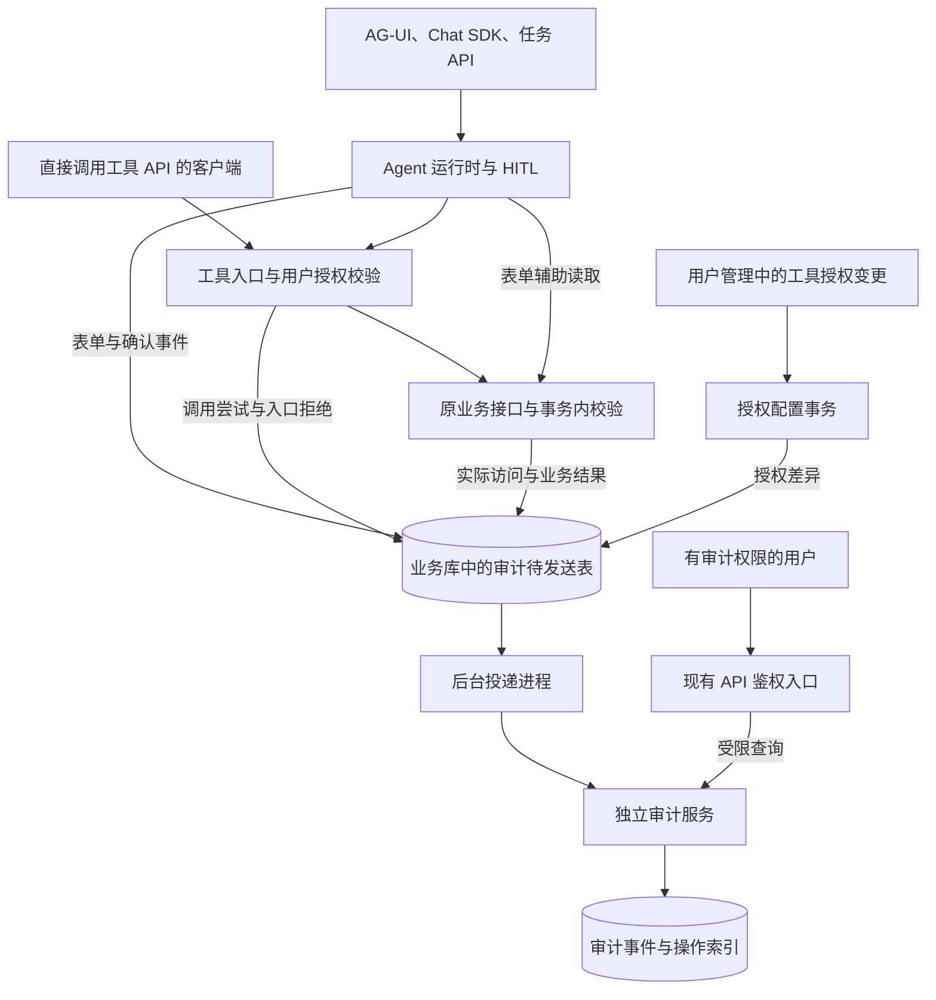

# Agent 操作与授权审计服务设计

审计服务已在 `agent_permissions` 下实现，支持独立运行。[查询接口与部署](agent-operation-audit.md)

服务以**一次业务操作**为查询单位，记录 Agent 代表哪个用户、谁给过工具授权、谁确认、访问了哪个接口和对象、当时依据什么权限放行或拒绝，以及操作最后是否生效。

用户级工具授权和原业务接口的 RBAC 继续决定能否执行。审计服务保存各个校验点**当时作出的判断**。即使后来改了角色、撤了授权、删除了聊天记录，仍能解释当时发生了什么。

## 1. 现有证据与接入位置

| 项目中已有的证据 | 本次需要补齐的部分 |
| --- | --- |
| 业务表 `audit_events` 已记录操作者、目标用户、动作、结果、请求 ID、来源、变更摘要和时间。用户工具授权变更还记录每项开关的前后值。 | 关联实际调用的 Agent、任务、授权版本和业务对象。成功的列表读取也需要一条可查询的操作记录。[业务审计](../service.py) · [用户工具授权](user-agent-tool-grants.md) |
| 工具入口 `POST /agent-tools/call` 做授权和版本检查，通过同进程 HTTP 调用原业务接口。两层请求分别生成请求 ID，工具封装还会返回内部接口的状态。 | 用一个服务端生成的调用 ID 关联两层。分别保留入口与业务 HTTP 状态，以便查清请求在哪一层被拒绝。[工具入口](../tooling.py) · [执行器](../../api_tools/executor.py) · [请求上下文](../api.py) |
| HITL 已保存表单提交、取消及执行回执。已接入的登录态写工具可在业务事务内保存执行结果。 | 关联表单、确认人和事务回执。HITL 的 `agent.tool.completed` 行即使在业务失败时也可能有 `outcome=success`，实际业务结果在 `changes.status`。[任务存储](../hitl_store.py) · [事务回执](../hitl_execution.py) |
| 表单取候选项、读取目标和核对版本会直接请求用户、角色等业务接口。 | 这些真实读取也记入审计，标记为“表单辅助读取”，挂在所属工具操作下。打开候选列表和提交重置密码能分别查到。[表单读取](../hitl_forms.py) · [交互路由](../hitl_api.py) |

## 2. 服务架构



业务侧负责采集和脱敏。独立服务负责接收、去重、保存、查询和到期清理。首版投递进程轮询业务库中的待发送表即可。生产可复用同一 PostgreSQL 实例，给审计库单独的数据库和账号。本地开发使用两个 SQLite 文件。LangSmith 的追踪 ID 可作为排障线索，审计查询直接读取审计库。

### 调用身份如何传递

- 运行时收到模型发出的工具申请时分配 `call_id`，用已有的 `(run_id, call_key)` 持久化关联。补参工具 `request_tool_input` 按注册表解析为实际业务操作。确认、取消和恢复沿用同一个调用 ID。每次独立尝试分配 `attempt_id`，表单辅助读取另建子调用，并保存 `parent_call_id`。
- 工具入口收到直接 SDK 请求时，自行分配 `call_id`。只有受信任的运行时上下文或已认证的客户端身份才能填 `agent_id`。只有用户令牌时，可以确认“哪个账号调用了工具入口”，客户端类型记为 `direct_tool_api`，Agent 身份留空。
- 当前同进程 ASGI 转发可用请求作用域内的 `ContextVar` 传递关联 ID，退出作用域时清理。实际用户仍由原接口验证会话后确定。客户端提交的用户名、模型参数、`X-Agent-*` 请求头均不作为归因凭据。普通页面直接操作业务接口时沿用业务审计。
- 入口同时采集模型申请、工具请求的鉴权失败和请求体校验拒绝，覆盖进入处理函数前的 422。所有权校验失败时，按请求者记录拒绝，外部传入的任务 ID 不能把事件挂到他人的任务。工具发现和打开表单只记录相应阶段，实际进入业务路由才记为“业务接口已收到”。
- 登录工具属于匿名入口，授权检查标记为不适用。成功后可关联新会话的已认证账号，失败时操作者可空。认证令牌和用户输入的登录名都从事件中剔除。

## 3. 一条记录要能查到什么

同一次操作在列表中占一行，详情保留按顺序追加的事件。以下字段是首版契约，有可靠来源时才填值。

| 问题 | 关键字段 | 取值依据 |
| --- | --- | --- |
| 谁在操作，代表谁 | `actor_user_id`、`subject_user_id`、`agent_id`、`entrypoint` | 分别表示本次请求的已认证操作者、权限所属用户、可信 Agent 标识和入口。当前会话通常由本人发起，两个人员字段可以相同。模型名仅作附加信息。 |
| 谁给过权限，谁确认 | `grant_changed_by_user_id`、`grant_changed_at`、`grant_version`、`confirmed_by_user_id`、`confirmed_at` | 记录该工具最近一次开关变更的操作者和时间。版本取该用户整份工具配置的 `users.agent_tools_version`。确认人取通过身份、所有权和表单版本检查并被服务端接受的提交。点击后遭拒仅记录尝试人。 |
| 做了什么、针对什么 | `operation_id`、`tool_name`、`http_method`、`route_template`、`effect`、`target_type`、`target_id`、`purpose` | 从注册表、匹配到的路由和实际业务对象取值。创建成功后补入新对象 ID，列表查询记录资源类型及允许的分页摘要。区分申请访问的目标与业务已核实的目标。 |
| 凭什么允许或拒绝 | `permission_checks`、`catalog_revision`、`reason_code` | 每次重要校验分别记录阶段、工具授权开关、所需的 all/any 权限、实际满足或缺失的相关权限、参与判断的角色及结果。提前拒绝后，后续检查记为 `not_evaluated`。 |
| 什么时候，花了多久 | `occurred_at`、`received_at`、`started_at`、`finished_at`、`duration_ms` | 事件保存源端 UTC 时间与审计入库时间，调用摘要保存起止时间。接口耗时使用单调时钟，人工等待时间由申请与确认时间另算。 |
| 接口是否执行，结果如何 | `dispatch_state`、`business_outcome`、`control_http_status`、`business_http_status`、`result_summary`、`change_summary` | 读取记录是否成功及允许的数量摘要，写入记录事务是否提交、实际变更字段或无变化。 |
| 如何核对原始证据 | `event_id`、`call_id`、`parent_call_id`、`attempt_id`、`run_id`、`interaction_id`、`execution_id`、入口和业务 `request_id` | 会话调用可一路关联到确认卡和业务回执。直接工具调用可没有任务和卡片。有对应业务审计时，额外保存 `business_audit_event_id`。 |

**权限证据取自作出判断的那次校验。** 工具入口记录它实际读取的授权与 RBAC 结果，业务服务在自己的鉴权事务内记录最终判定。按参数触发的额外权限也要记录，例如创建用户并指定角色时检查的 `user.roles.assign`。表单辅助读取分别记录父操作的授权检查和子接口本身的 RBAC 检查。

管理员替用户打开或关闭工具时，在原配置事务中按 `subject_user_id + operation_id + grant_version` 产生变更事件，记录前后值、修改人、时间和原业务审计 ID。最后修改人可能是撤权人，因此详情同时展示修改方向。需要核对谁调整过角色时，可追溯原业务审计里的 `user.roles.assign` 或 `role.update`。

## 4. 如何判定操作结果

每次尝试有两个独立字段。`dispatch_state` 取 `not_sent`、`attempted` 或 `received`，分别说明尚未派发、已经尝试派发、原接口确认收到。`business_outcome` 取 `not_executed`、`succeeded`、`failed` 或 `unknown`。点击确认、入口返回成功、业务事务提交是三个不同的事实。

| 发生的事情 | 记录的证据与业务结果 |
| --- | --- |
| Agent 选中工具，或用户在填写表单 | 保存调用申请、表单、版本和等待状态。业务结果为尚未执行。 |
| 工具授权、RBAC、表单版本或参数校验失败 | 保存拒绝或校验失败的那一次尝试、阶段和安全错误码。原业务路由尚未进入时，业务 HTTP 状态为空。表单仍可处理时，整项保持等待。 |
| 用户确认、取消或卡片到期 | 接受确认后写入确认人和版本，再走执行时校验。派发前取消或到期记录对应原因，业务结果仍为尚未执行。 |
| 成功读取业务数据 | 业务路由记录实际访问，工具侧在放行响应前持久化读取结果摘要。可以回答“读取了什么范围”，查询内容与完整结果均省略。 |
| 写入提交、业务拒绝或回滚 | 成功事件、目标 ID 和事务回执随业务事务一起提交。明确无变更时标记 `no_change`。明确回滚后用独立短事务记录失败原因。权限导致的业务层拒绝保留内部接口实际返回的状态。 |
| 请求超时、响应丢失、取消与提交交错 | 已派发但证据不足时记为 `unknown`。以事务回执对账，追加“已核实提交”或“已核实回滚”事件。已提交的写入保持成功，核对过程只读取证据。 |

### 确认前撤销重置密码工具的例子

下表使用示例账号与 UTC 时间。

| 时间 | 人员与动作 | 审计详情 |
| --- | --- | --- |
| 09:00 | 管理员 A 给用户 B 开启 `user.password.reset` | 修改人 A，权限所属用户 B，授权版本 7，开关由关变开。 |
| 09:05 | B 在会话中要求重置用户 C 的密码，并选定目标 | 一次重置申请，目标 C，等待 B 确认。若页面读取了 C 的资料，该读取有独立子记录。 |
| 09:06 | A 撤销 B 的该项工具授权 | 授权版本 8，开关由开变关。 |
| 09:07 | B 点击确认，服务端重新校验 | 此次确认尝试人为 B，`403 TOOL_NOT_GRANTED`，确认人为空，重置请求尚未派发。C 的密码保持原值。 |

若 B 在授权有效时完成同一操作，详情应能查到 `PUT /api/v1/users/{user_id}/password`、目标 C、确认人 B、提交时间与 `password_changed=true`。即使调用端随后断线，业务事务回执仍可证明重置已生效。外层 HTTP 200 也可能封装内部接口的失败，业务结果按内部响应与事务证据判定。

## 5. 存储、投递与故障处理

| 位置 | 建议表 | 职责与约束 |
| --- | --- | --- |
| 业务库 | `agent_audit_call_refs` | 保存调用 ID、父调用、任务调用键和下一个事件序号。任务调用键在同一任务内唯一。直接工具请求每次分配新 ID。 |
| 业务库 | `agent_audit_outbox` | 用 `event_id` 标识脱敏后的待发送事件，保存重试时间、租约和投递状态。对同一次业务事实设唯一键，例如事务成功按 `execution_id` 去重，匿名登录工具可按服务端调用 ID 去重。 |
| 审计库 | `agent_audit_events` | 保存脱敏事件、类型与结构版本，按 `(producer_id, event_id)` 唯一。调用内的序号与源事件在同一事务内分配，授权配置变更按用户和配置版本排序。 |
| 审计库 | `agent_audit_operations` | 每次调用一行，从事件生成列表与详情摘要，可由事件重建。按用户、操作、目标、结果与时间建立查询索引。 |

1. **先有本地证据，再执行业务。** 调用进入业务派发前先持久化尝试。登录态写工具在现有 `record_execution` 所在的业务事务写入成功事件，公开登录工具在创建会话的事务写入。若事务内写审计失败，业务一起回滚。读取在交付数据前落本地结果事件。新增工具默认采集公共字段，有副作用的工具还须验证成功事件与业务提交原子一致。
2. **审计服务短时离线时，业务仍可使用本地待发送表。** 投递进程批量认领、重试，审计服务在事件与查询摘要均持久化后才确认。确认丢失会再次投递相同 ID。同 ID 不同内容进入隔离队列并告警。乱序到达时保留全部事件，按源序号补齐摘要，晚到的“等待”不会覆盖已证实的提交。[事务性 Outbox 模式](https://docs.aws.amazon.com/prescriptive-guidance/latest/cloud-design-patterns/transactional-outbox.html)
3. **本地证据无法持久化时，明确告知调用方。** 对原本允许、尚未派发的调用返回 `503 AUDIT_UNAVAILABLE`。读取已发生但结果事件无法保存时，同样返回 503，已持久化的尝试保留为待核对。已确定的鉴权拒绝维持原有 401/403。本地存储故障导致拒绝证据缺失时，通过独立运行监控报告时间窗口和请求 ID。
4. **核对缺失结果时只读取业务证据。** 使用调用键、提交 ID 和执行回执关联相同的表单重试。两次独立发起的业务操作即使参数相同，也有各自的调用记录。监控待发送数量、最老事件延迟、隔离事件和超时未核实调用。终态缺失时先核对现有回执，保留核对人、时间与依据。

## 6. 查询权限、数据最小化与保留

首版建议单设 RBAC 权限 `agent.audit.read`，初始授予内置管理员，其他角色显式授予。列表、详情和授权变更接口均通过现有用户会话逐次鉴权。内部接收接口通过 TLS 校验投递服务身份，网关查询使用独立的只读服务身份。审计接口声明 `x-agent.expose=false`，查阅审计的行为进入管理访问日志。

| 拟新增接口 | 用途 |
| --- | --- |
| `GET /api/v1/audit/agent-operations` | 按 UTC 时间区间、权限所属用户、Agent、操作 ID、目标、结果或任务筛选。按 `(started_at, call_id)` 倒序游标分页。默认展示主调用，可显式包含辅助读取。 |
| `GET /api/v1/audit/agent-operations/{call_id}` | 查看各次尝试、授权依据、确认人、业务结果、子调用和关联请求 ID。 |
| `GET /api/v1/audit/agent-grant-changes` | 查看哪个管理员在何时给哪个用户开启或关闭了哪项工具，可按用户、操作和版本定位。 |
| `POST /internal/v1/agent-audit/events` | 内网投递批次并逐条确认。事件结构、允许字段、长度和来源均由接收端校验。 |

内部投递体包含 `schema_version`、`producer_id` 和 `events[]`。以下为一次用户列表查询的示例事件节选。接收方对每个事件返回已保存、重复或拒绝及原因，投递方据此确认或重试。

```json
{
  "event_id": "evt_read_03", "event_type": "read.succeeded", "sequence": 3,
  "call_id": "call_list_1", "attempt_id": "attempt_1",
  "occurred_at": "2026-11-18T09:11:00Z", "duration_ms": 17,
  "actor_user_id": "user_b", "subject_user_id": "user_b", "agent_id": "agent_permissions.chat",
  "operation_id": "user.list", "http_method": "GET", "route_template": "/api/v1/users",
  "permission_checks": [
    {"stage": "tool_entry", "check": "user_grant", "decision": "allowed"},
    {"stage": "business", "check": "rbac", "required_all": ["user.read"], "decision": "allowed"}
  ],
  "dispatch_state": "received", "business_outcome": "succeeded",
  "business_http_status": 200, "result_summary": {"returned_count": 10}
}
```

首版字段采用白名单，在写入业务库待发送表**之前**完成裁剪。密码、密码哈希、令牌、Cookie、密钥、表单 `sensitive_values`、完整请求与响应、聊天正文和思考内容均从事件中剔除。列表查询可记页大小与实际返回条数，自由搜索词省略。未知工具名或错误文本若无法安全归一化，只留请求 ID 和受控原因码。重试、隔离队列和告警使用同一份脱敏数据。[OWASP 日志字段与排除项](https://cheatsheetseries.owasp.org/cheatsheets/Logging_Cheat_Sheet.html#data-to-exclude)

建议首版审计明细保留 **90 天**并允许配置，最终期限由业务负责人确认。已投递的本地事件建议保留 7 天，积压、隔离和待核对记录先处理再清理。审计写入账号只有追加事件权限，例行清理由独立维护账号执行并留痕。事件以稳定 ID 保存，聊天清理和账号删除均不触发审计级联删除。

## 7. 实施顺序与验收

1. **先接入一读一写。** 新增业务库迁移、事件契约、独立审计服务与投递进程，以 `user.list` 和 `user.password.reset` 贯通读取、拒绝和业务提交。复用现有工具元数据与事务回执。
2. **覆盖所有入口。** 接入 AG-UI、OpenAI 兼容 Chat、任务 API、直接工具调用、HITL 辅助读取和授权配置变更。同步更新 SQLite、PostgreSQL 初始化、升级和迁移清单。上线时记录采集起点，早期业务审计按已有证据查阅。
3. **开放受控查询。** 提供列表、详情、运行监控和保留期清理。在控制台需要页面时复用上述查询接口。上线前在两种存储后端测量新增事务耗时、列表读取量和投递积压恢复时间。

| 验收场景 | 通过条件 |
| --- | --- |
| B 通过 Agent 查询 C，另有人直接从用户管理查询 C | Agent 审计准确显示 B、目标 C 以及工具读取的结果。手工页面访问遵循原业务审计范围。使用工具入口的直接 SDK 请求可归到已认证账号。 |
| B 的工具开关已开但角色缺权限，或授权在确认前被撤销 | 能查到实际拒绝阶段、原因码和当时的授权依据。尚未进入的业务接口没有成功记录。 |
| 输入有误、取消、卡片过期、重复确认或任务恢复 | 每次尝试可追溯，一次真实提交只统计一次。表单辅助读取按读操作计数。 |
| 业务提交后丢失 HTTP 响应，或回滚后服务重启 | 提交可由同事务事件和回执核实。回滚只留下尝试、失败或待核实的证据。 |
| 审计服务停机后恢复，投递重复或顺序颠倒 | 合法调用可先写本地，恢复后事件完整、摘要可重建、统计无重复。业务库无法写待发送表时，新的业务写入不会生效。 |
| 伪造调用人、跨账号访问卡片、普通用户查审计，或提供密码及令牌 | 身份来自可信上下文，越权读取被拒。原始事件、查询结果、重试及告警中均找不到秘密值。 |
