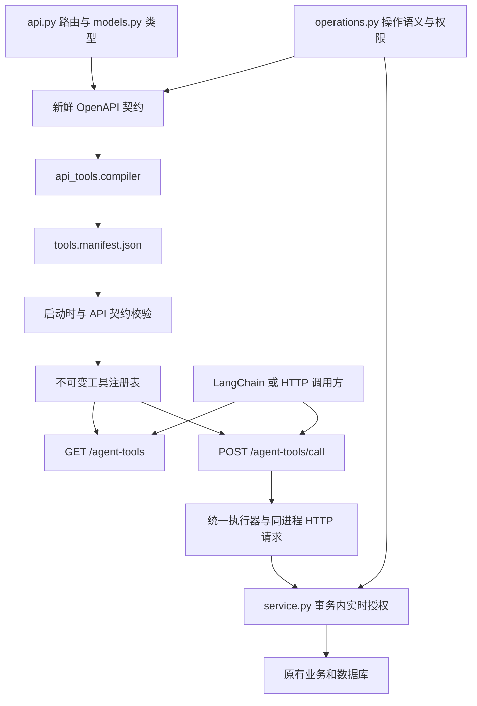

# API Agent 工具使用与同步

用户管理服务从 23 个业务接口生成对应的 Agent 工具，涵盖登录、退出、用户管理、个人设置、角色权限和模型用量。工具沿原有 HTTP 路由执行，沿用事务、实时 RBAC、会话撤销、版本校验、限流和业务审计。

当前实现对应[设计方案](../../api-agent-tools-design.md)的第一阶段。通用生成、执行和 LangChain 适配代码位于 [api_tools](../../api_tools/)，项目只提供操作元数据、可信会话上下文和同源调用入口。

## 1. 架构与维护入口



新增或修改业务接口时，维护原有路由、请求响应类型和 `operations.py` 中的操作声明。路由的 `name` 作为稳定 `operationId`，`ContractRoute` 自动把说明和权限导出为 `x-agent`。服务层从同一操作声明读取所需权限，并在原有业务事务内检查。

工具名称为 `agent_users_` 加上转换后的 `operationId`，例如 `user.self.read` 对应 `agent_users_user_self_read`。路径调整时保持操作标识稳定；语义或输入结构不兼容时使用新工具标识或兼容版本。

| 模型用量工具 | 绑定接口 | 授权要求 |
| --- | --- | --- |
| `agent_users_user_self_token_usage` | `GET /api/v1/users/me/token-usage` | 当前账号的会话和该工具的 Agent 授权。 |
| `agent_users_user_token_usage` | `GET /api/v1/users/{user_id}/token-usage` | 当前账号的会话、该工具的 Agent 授权和 `agent.usage.read`。 |

两个工具均接受可选的 `query.from_date` 和 `query.to_date`，按北京时间统计。查询指定账号需提供 `path.user_id`，Agent 可通过表单收集缺少的目标 ID。[用量接口](chat-api.md#按用户查询模型用量)

不用编写逐个工具的包装函数。新增路由未声明元数据、隐藏的业务路由、标识冲突、路由与契约遗漏、不支持的 Schema 都会使生成或启动失败。Console、文档页面、静态资源以及工具控制入口有明确的排除声明。

## 2. 生成与校验工具包

在仓库根目录运行，复用根目录的环境：

```bash
uv sync --locked
uv run python -m agent_permissions.tools build
uv run python -m agent_permissions.tools check
```

默认输出为 `agent_permissions/build/tools.manifest.json`。`build/` 已由仓库规则忽略，产物随发布携带，不提交到源码。生成过程只读取路由和类型，不初始化数据库。

工具包包括 `sourceRevision`、`generatorVersion`、`targetProfile`、`bundleDigest`、工具定义、执行映射及排除清单。定义与映射在同一个摘要内，文件被修改或与 API 不匹配时校验失败。

与上一发布版本比较：

```bash
uv run python -m agent_permissions.tools diff --baseline /path/to/previous/tools.manifest.json
```

差异报告包含新增、删除、修改和破坏性变化。新增可选对象字段可以自动判定为兼容；新增必填字段、改类型、删除工具、权限变化或响应变化采取保守分类并返回非零退出码。已完成兼容处理或明确接受变化的发布，可显式使用 `--allow-breaking`。该参数只影响发布检查，不会让旧客户端参数自动适配新接口。

CI 中需要接受破坏性发布时，提交 `agent_permissions/tool-release.json`，使用 `baselineDigest`、`candidateDigest`、`breakingTools` 和非空 `reason` 绑定两版摘要、差异报告中的完整工具名称及变更原因。CI 将其传入 `--compatibility` 检查，两版摘要或工具清单发生变化后声明即失效。该文件是可评审的发布决策，不包含生成的工具包。

`.github/workflows/api-tools.yml` 在相关代码发生变化时生成并校验工具包、运行工具与原有 API 回归、执行代码检查，并在存在上一版本编译器时比较上一提交或 PR 基线。检查发现不兼容变化会阻止通过。

## 3. 启动并绑定发布版本

开发环境直接启动即可，工具注册表在 lifespan 启动阶段自动生成。使用 Uvicorn 的 `--reload` 可以在 Python 文件变化后重启并重新生成；运行中的注册表保持为一个完整快照。

```bash
uv run uvicorn agent_permissions.main:app --host 127.0.0.1 --port 8000 --no-proxy-headers --reload
```

发布时先完成 Console 构建等会影响实际路由的构建步骤，再生成工具包，并显式指定该产物启动：

```bash
uv run python -m agent_permissions.tools build
uv run python -m agent_permissions.tools check
AGENT_USERS_TOOLS_MANIFEST=agent_permissions/build/tools.manifest.json uv run uvicorn agent_permissions.main:app --host 127.0.0.1 --port 8000 --no-proxy-headers --env-file agent_permissions/deploy/.env
```

指定工具包时，启动在连接数据库前比对完整契约与工具包，不匹配则停止。回滚使用同一旧构建中的 API 代码和工具包一起启动。当前为单服务部署；多版本独立网关与跨实例版本路由属于设计方案第二阶段。

## 4. 工具发现

`GET /agent-tools` 返回当前调用者可见的工具定义：

```json
{
  "bundleDigest": "当前工具包的 64 位摘要",
  "sourceRevision": "接口契约摘要",
  "tools": [
    {
      "name": "agent_users_user_self_read",
      "description": "查看当前用户资料，返回 version 和 ETag，修改前应重新读取。",
      "inputSchema": {},
      "outputSchema": {},
      "annotations": {}
    }
  ],
  "cacheMaxAgeSeconds": 0
}
```

上例的 Schema 仅为示意，实际返回包含完整字段与约束。匿名调用者仅看到登录工具；登录用户在登录工具之外，只看到自己已允许且当前 RBAC 允许的工具。管理员也需要显式开启工具，新用户和升级后的用户默认未授权。页面入口与接口见[用户级 Agent 工具授权](user-agent-tool-grants.md)。工具控制接口和用户授权配置接口不会再次生成工具。

请求可使用 `Authorization: Bearer ...`。已失效的会话返回 `401`。权限与工具开关从数据库读取，角色变更保留用户开关，不需要重新生成工具包。目录一次返回全部可见定义，设置 `Cache-Control: private, no-store`，不涉及跨页快照。

## 5. 工具调用与结果

`POST /agent-tools/call` 使用可信会话请求头和以下请求体：

```json
{
  "name": "agent_users_user_update",
  "revision": "发现接口返回的 bundleDigest",
  "arguments": {
    "path": {"user_id": "usr_example"},
    "header": {"If-Match": "\"v3\""},
    "body": {"display_name": "新的展示名称"}
  }
}
```

`revision` 实际必须为 64 位十六进制摘要。参数按 `path`、`query`、`header`、`body` 分组。凭据从 HTTP 上下文获取，不能通过工具参数覆盖 `Authorization`、目标主机或工具版本。返回的 `headers.etag` 可用于下次写操作的 `header.If-Match`。

结果结构为：

```json
{
  "ok": true,
  "httpStatus": 200,
  "body": {
    "data": {"id": "usr_example", "display_name": "新的展示名称"},
    "request_id": "req_example"
  },
  "headers": {"etag": "\"v4\""},
  "requestId": "req_example",
  "bundleDigest": "本次工具包摘要"
}
```

示例省略了用户结果中的其余字段。`body` 保留原有 API 响应，包括业务错误码、`request_id` 和空响应；`httpStatus` 表示业务 API 的 HTTP 状态。工具控制调用成功完成时外层 HTTP 为 `200`，业务失败通过 `ok: false`、`httpStatus` 和 `body.error` 表达。

工具层自身拒绝调用时，外层直接返回错误状态和既有 `ErrorResponse` 格式：

| 错误码 | HTTP 状态 | 调用方处理 |
| --- | --- | --- |
| `TOOL_UNAVAILABLE` | 404 | 工具不存在或已删除，刷新目录 |
| `TOOL_VERSION_MISMATCH` | 409 | 工具版本变化，结束当前工具选择并重新发现 |
| `TOOL_INPUT_INVALID` | 422 | 根据当前 Schema 修正参数 |
| `PERMISSION_DENIED` | 403 | 当前用户没有执行权限 |
| `TOOL_NOT_GRANTED` | 403 | 当前用户未允许 Agent 调用此工具 |
| `UNAUTHENTICATED` | 401 | 会话无效，重新认证 |
| `TOOL_OUTPUT_INVALID` | 502 | 响应契约不匹配，先确认业务操作结果 |
| `TOOL_RESULT_UNKNOWN` | 504 | 调用超时，先查询结果，避免重复写入 |
| `TOOL_TRANSPORT_ERROR` | 502 | 请求未正常完成，通过请求标识排查 |

统一执行器不自动重试。业务写操作的版本冲突、最后管理员保护、角色授权限制及会话撤销继续由原有 API 执行。工具调用通过 HTTPX ASGITransport 进入同一个 FastAPI 应用，不建立外部代理；原请求来源被保留用于限流。

JSON 请求体区分缺省字段与显式 `null`。查询或请求头中的 `null` 无法无损转换为 HTTP，需省略该参数。当前支持标量参数、简单数组、JSON 对象和嵌套模型；对象型查询参数、递归或外部 Schema 引用、文件上传及流式内容会明确报错。

## 6. LangChain 接入

模型使用本项目的 `from agent_permissions.chat_model import create_chat_model`，独立配置及完整 Agent 示例见 [项目独立模型配置](model.md)。

宿主先完成登录并安全保存会话令牌，再注入工具客户端的 `token_provider`。每轮 Agent 任务开始前调用 `langchain_tools()`，它会重新发现工具，生成的 callable 绑定本轮工具版本。

```python
import httpx

from api_tools.client import AgentToolClient


async def load_tools(session_token: str):
    async with httpx.AsyncClient(
        base_url="http://127.0.0.1:8000",
        trust_env=False,
        timeout=30,
    ) as http:
        adapter = AgentToolClient(http, token_provider=lambda: session_token)
        tools = await adapter.langchain_tools()
        lookup = {tool.name: tool for tool in tools}

        # 可直接调用验证，也可在这个 client 上下文内传给 create_agent 的 tools 参数。
        result = await lookup["agent_users_user_self_read"].ainvoke({})
        return result
```

真实 Agent 应在 HTTP client 生命周期内执行。令牌不进入工具参数或工具定义，工具 SDK 不保存角色快照；执行端逐次检查当前会话、用户工具授权和权限。运行示例前先在用户页面开启对应工具。登录工具也已生成，通常由宿主认证流程调用，避免把认证结果交给模型管理。

工具版本变化后，已创建的 callable 返回 `TOOL_VERSION_MISMATCH`，不会悄悄用新 Schema 继续执行。宿主应重新发现并让 Agent 重新决定参数，写操作不会自动回放。新一轮任务可以使用更新后的工具集合。

当前提供 HTTP 和 LangChain 适配器，没有实现 MCP 协议端点、MCP 列表变更通知、多服务网关或跨版本流量切换。

## 7. 离线验收

```bash
uv run python -m unittest api_tools.test_tools agent_permissions.test_tools agent_permissions.test_api agent_permissions.test_rbac agent_permissions.test_console agent_permissions.test_connection_pool.PoolConfigurationTests agent_permissions.test_connection_pool.DatabaseLifecycleTests -v
uv run ruff check api_tools agent_permissions
uv run ruff format --check api_tools agent_permissions
```

测试使用临时 SQLite，覆盖全部 23 个工具的真实 HTTP 调用，以及新增参数、必填参数变化、路由新增或删除、未分类路由、旧版本 callable、权限撤销、匿名访问、无效输入、超时与响应结构不匹配。测试不访问现有业务数据库，不调用真实模型。
