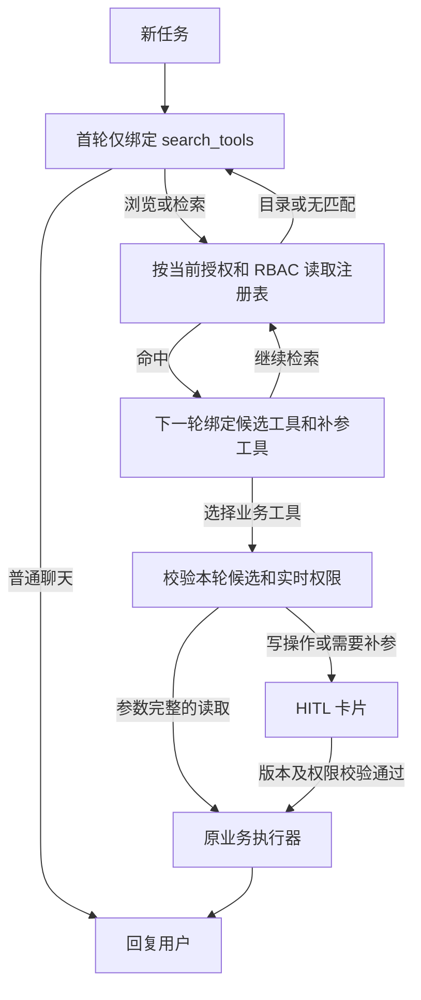

# Agent 按需发现业务工具

## 目标

新任务首轮只向模型提供普通 Responses 函数工具 `search_tools`。问候可以直接回复。用户可以查询自己能使用的工具，业务请求则先查找候选，再由模型选择具体操作。OpenAI SDK Chat、Console 和 AG-UI 共用同一执行图。

## 目录和搜索

目录来自已激活的 API 工具注册表。服务端取当前会话用户已授权给 Agent 且通过业务 RBAC 的操作。工具增加、下线或变更后，以当前注册表为准。

| 调用 | 返回给模型 | 下一轮绑定 |
| --- | --- | --- |
| `search_tools(query="", page=1)` | 可用总数、当前页、下一页和最多 10 条摘要，按操作 ID 稳定排序 | 仅搜索工具 |
| `search_tools(query="查询用户列表")` | 最多 3 个匹配项，含操作 ID、函数名、中文名称和读写性质 | 搜索工具、匹配的真实函数及限定候选范围的 `request_tool_input` |
| 关键词无匹配 | 空结果，模型可换词或请用户澄清 | 仅搜索工具 |

检索优先匹配操作 ID 和函数名。关键词包含可识别的动作、对象时，先匹配这两项。比如“创建用户”只会匹配能够为用户执行创建操作的候选。其余关键词按中文名称、操作 ID、资源分组与接口说明的匹配程度排序，支持常见中英文同义词。分数低于最佳匹配一半的条目会被过滤，同分时按操作 ID 排序。浏览目录和搜索都只读元数据。零授权账号可以查询空目录。显式传入 `tool_choice="none"` 时关闭全部工具。

## 执行与恢复

每次模型调用根据当前候选重新绑定工具。服务端按本轮实际提供的操作校验模型返回的调用。同一条模型回复中的搜索结果从下一轮起生效。多次搜索按调用顺序处理，最后一次搜索决定下一轮候选。开新任务时从空集合开始。checkpoint 保存候选操作 ID、工具包版本以及执行该轮待办所需的绑定范围。恢复时重新检查当前用户的权限和工具版本。升级前已产生的待办继续走原有确认、授权和执行回执流程。

搜索作为发现步骤展示。业务工具的执行记录、幂等回执、敏感参数脱敏和取消版本校验沿用现有实现。搜索命中与业务操作成功分别记录。

搜索只需要能力关键词。模型偶尔会把姓名或密码填进搜索参数，因此服务端把自由文本转换为匹配的注册表操作 ID 后再写入模型历史和 checkpoint。无匹配时保存空结果标记。包含无效字段的调用返回参数错误。用户仍在原有 HITL 表单中提交敏感参数。

## 验收

- 检查普通和流式 Responses 的实际请求，首轮仅含搜索，候选轮只含命中工具，补参枚举与候选一致。
- 覆盖问候、按页列目录、关键词和 ID 检索、无匹配、零授权、禁用工具以及跨用户隔离。
- 验证模型直接猜测工具、搜索后撤权、角色权限变化、工具版本变化和同轮混合调用的处理。
- 验证读操作执行、写操作暂停、刷新或重启后恢复，以及旧 checkpoint 的兼容性。使用既有 SQLite、PostgreSQL 和 Console 回归验证对外协议。

## 问候的实际用量

在拥有 20 个业务工具的临时测试账号上，用项目配置的 `ZhipuAI/GLM-5.3` Responses API 分别发送一次“你好”。两次均使用新会话和同一模型设置。

| 首轮发给模型的函数 | 输入 tokens | 输出 tokens | 总 tokens |
| --- | ---: | ---: | ---: |
| 原有 20 个业务函数和 1 个补参函数 | 4,160 | 130 | 4,290 |
| 单个 `search_tools` | 336 | 53 | 389 |

该次问候无需搜索，首轮输入减少约 92%。业务查询通常多一次模型往返，用于查找候选。完整任务用量还取决于会话历史、查询结果和模型回复长度。
