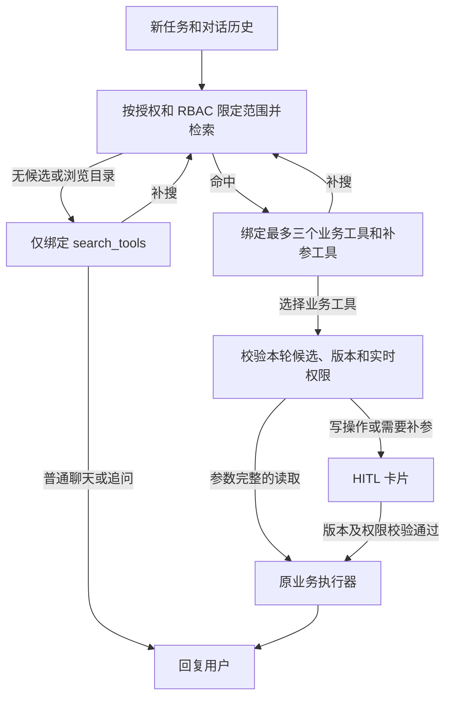

# Agent 按需发现业务工具

## 目标

OpenAI SDK Chat、Console 和 AG-UI 共用同一执行图。新任务进入模型前，服务端先按用户意图检索，最多绑定 3 个业务工具的完整参数定义。模型可以首轮发起业务调用。问候、浏览目录和未匹配的请求只绑定 `search_tools`。命中候选时还提供对应的 `request_tool_input`。

## 目录和搜索

工具包激活时，服务端用注册表中的操作 ID、函数名、中文名称、分组和描述，以及 `OperationSpec.search_examples` 中的典型问法构建内存向量索引。索引使用 TF-IDF 和截断奇异值分解（潜在语义分析，LSA），在本地计算查询向量。新操作可以直接使用注册表元数据，也可以补充“换昵称”“冻结账号”一类业务说法。索引按工具包版本和检索文本缓存，用户消息与授权结果只在本次检索中使用。

服务端先取当前用户的 Agent 授权与实时 RBAC 的交集。显式操作 ID 或函数名优先精确匹配，自然语言查询在该交集中综合关键词和向量余弦相似度排序。动作和对象用于区分“创建用户”和“删除用户”。只有“查询”这样缺少业务对象的重合词时，模型可以追问或补搜。这种本地模型能识别的概念取决于目录和示例的覆盖范围。

新任务使用请求中最后一条用户消息。“那上个月呢”“下一页呢”这类追问会结合消息历史中前一次独立的用户请求，只选读取工具。切换话题后按新消息重新检索。SDK 调用方和 Console 一样，通过 `messages` 传递对话历史。

| 调用 | 返回给模型 | 下一轮绑定 |
| --- | --- | --- |
| `search_tools(query="", page=1)` | 可用总数、当前页、下一页和最多 10 条摘要，按操作 ID 稳定排序 | 仅搜索工具 |
| `search_tools(query="查询用户列表")` | 最多 3 个匹配项，含操作 ID、函数名、中文名称和读写性质 | 搜索工具、匹配的真实函数及限定候选范围的 `request_tool_input` |
| 关键词无匹配 | 空结果，模型可换词或请用户澄清 | 仅搜索工具 |

模型使用 `search_tools` 浏览目录，或在多步任务中补搜新的能力。补搜和首轮使用同一套排序。零授权账号可以查询空目录。显式传入 `tool_choice="none"` 时关闭全部工具。

## 执行与恢复

每次模型调用都根据当前候选重新绑定工具。服务端按本轮实际提供的操作校验模型返回的调用。同一条模型回复中的补搜结果从下一轮起生效。多次补搜按调用顺序处理，最后一次决定下一轮候选。checkpoint 保存候选操作 ID、工具包版本以及执行该轮待办所需的绑定范围。恢复时重新检查当前用户的权限和工具版本。

模型主动补搜时，会话展示发现步骤。业务工具的执行记录、幂等回执、敏感参数脱敏和取消版本校验沿用现有实现。搜索命中与业务操作成功分别记录。

搜索只需要能力关键词。模型偶尔会把姓名或密码填进搜索参数，因此服务端把自由文本转换为匹配的注册表操作 ID 后再写入模型历史和 checkpoint。无匹配时保存空结果标记。包含无效字段的调用返回参数错误。用户仍在原有 HITL 表单中提交敏感参数。

## 验收

使用相同的 22 个会话工具和 10 条标注问法作离线对照。基线提交 `85cd7bd` 的关键词检索有 7 条将正确工具排进前三，当前混合检索有 10 条。“我想换个昵称”“先让这个同事暂时登不进来”“我用掉了多少词元”是补上的三个命中。问法与断言见[工具发现测试](../test_tool_discovery.py)。这组数据覆盖回归场景，线上效果还取决于实际用户的表达。

- 检查普通和流式调用，包括首轮直接发起读取或等待写入确认、仅下发候选的参数定义，以及补参枚举与候选一致。
- 覆盖问候、按页列目录、关键词和 ID 检索、无匹配、零授权、禁用工具以及跨用户隔离。
- 验证模型直接猜测工具、搜索后撤权、角色权限变化、工具版本变化和同轮混合调用的处理。
- 验证读操作执行、写操作暂停、刷新或重启后恢复，以及旧 checkpoint 的兼容性。使用既有 SQLite、PostgreSQL 和 Console 回归验证对外协议。

## 问候的实际用量

在拥有 20 个业务工具的临时测试账号上，用项目配置的 `ZhipuAI/GLM-5.3` Responses API 分别发送一次“你好”。两次均使用新会话和同一模型设置。

| 首轮发给模型的函数 | 输入 tokens | 输出 tokens | 总 tokens |
| --- | ---: | ---: | ---: |
| 原有 20 个业务函数和 1 个补参函数 | 4,160 | 130 | 4,290 |
| 单个 `search_tools` | 336 | 53 | 389 |

该次问候的首轮输入减少约 92%。这组历史测量比较了全量工具与单个搜索工具。当前实现可以在明确的业务查询中省去一次显式搜索，实际 token 用量和延迟取决于模型、会话历史和候选规模。
