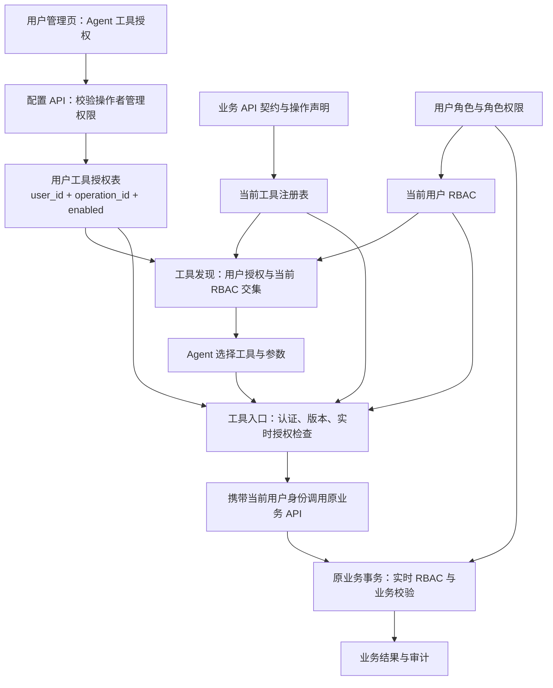

# 用户级 Agent 工具授权改造方案

状态：已实施。本文保留改造时的设计依据与实施拆分；当前操作方式及接口契约见[用户级 Agent 工具授权](user-agent-tool-grants.md)。

## 1. 已确认的目标

为每个用户独立配置允许 Agent 调用的工具，在用户管理页面提供配置入口。Agent 以当前登录用户的身份执行操作，实际业务操作继续遵守已有 RBAC、资源检查、版本校验和业务约束。

以下规则是本次改造的基础：

1. 授权主体是用户，一条配置对应 `用户 + 工具操作`，同角色用户可以配置不同的工具。
2. Agent 授权与业务权限独立。用户没有某项业务权限时，仍可保存对应工具的“允许”设置。
3. 修改用户角色、角色权限时，保留 Agent 授权设置，不自动关闭、删除或重建配置。
4. Agent 授权不会增加用户的业务权限。每次业务操作仍由原有服务端 RBAC 决定是否放行。
5. 用户以后获得业务权限时，已保存的“允许”设置可以生效；失去业务权限后，配置保留，调用被拒绝。
6. 缺少配置视为不允许；新用户、新工具均默认不允许。管理员执行工具也遵守自己的 Agent 授权配置。

本期配置入口放在用户管理页，由具备管理权限的操作者修改目标用户配置。配置归属与修改者身份是两回事：例如管理员为张三保存配置，影响的是张三的 Agent。普通用户在个人设置中自行授权、按会话或不同 Agent 分别授权、审批和到期授权不纳入本期。

## 2. 当前实现与改造位置

当前没有直接保存用户权限的 `user_permissions` 表，业务权限由 `user_roles → role_permissions` 计算，多个角色取并集。不能在共享的 `permissions` 或 `role_permissions` 中增加一个开关来表达用户级委托，否则同角色用户会共享配置。

当前已有以下可复用能力：

| 位置 | 现有能力 | 本期改造 |
| --- | --- | --- |
| [operations.py](../operations.py) | 稳定操作 ID、描述、所需权限和操作性质 | 继续作为操作语义来源，补充配置页面所需的名称、分组及控制接口排除声明 |
| [tooling.py](../tooling.py) | 工具发现、会话上下文、调用入口 | 增加用户授权过滤和调用前检查 |
| [api_tools/executor.py](../../api_tools/executor.py) | 工具版本、参数、权限预检和同源 HTTP 调用 | 保留通用职责，不加入项目数据库表查询 |
| [service.py](../service.py) | 会话认证、事务内实时 RBAC、业务处理和审计 | 增加配置查询与保存；保留原业务鉴权 |
| [UsersPage.tsx](../console/src/UsersPage.tsx) | 用户列表、按权限显示行操作 | 增加“Agent 工具授权”入口 |
| [database.py](../database.py)、[postgres.py](../postgres.py) | SQLite / PostgreSQL schema 2 | 事务化升级至 schema 3 |

当前工具包包含 23 个工具。其中 22 个需要用户会话，可在用户页面配置 Agent 授权，包括退出登录、个人账号操作和模型用量查询。`auth.login` 服务于匿名认证。

## 3. 授权模型

对用户 `u` 和工具操作 `t`，分别计算：

```text
agent_enabled(u, t) = 数据库中该用户是否允许 Agent 调用该操作
rbac_allowed(u, t)  = 用户当前角色权限是否满足该操作的 all / any 权限要求

权限层面可调用 = 用户身份有效 AND 工具仍可用
               AND agent_enabled(u, t) AND rbac_allowed(u, t)
```

`rbac_allowed` 和“权限层面可调用”都是实时计算结果，不写回授权表。通过这些检查后，业务接口仍可能因资源范围、版本冲突、最后管理员保护等约束拒绝操作。

| Agent 设置 | 当前 RBAC | 页面状态 | Agent 调用 |
| --- | --- | --- | --- |
| 不允许 | 无权限 | 未授权 | 工具入口拒绝 |
| 不允许 | 有权限 | 未授权 | 工具入口拒绝 |
| 允许 | 无权限 | 已允许，当前缺少业务权限 | 权限检查拒绝，配置保留 |
| 允许 | 有权限 | 已允许，当前业务权限满足 | 进入原业务处理，继续检查业务条件 |

现有工具执行器会做 RBAC 预检，因此已知没有权限时可以提前返回 `PERMISSION_DENIED`。即使预检通过，实际业务接口仍会在自己的事务内重新鉴权，不能把预检当作最终授权。

## 4. 数据设计

### 4.1 用户工具授权表

新增 `user_agent_tool_grants`：

| 字段 | 类型 / 约束 | 含义 |
| --- | --- | --- |
| `user_id` | TEXT，关联 `users.id`，非空 | 被代理的用户 |
| `operation_id` | TEXT，非空 | 稳定操作标识，例如 `user.list` |
| `enabled` | INTEGER，0 / 1，默认 0 | 用户是否允许 Agent 调用 |
| `updated_by` | TEXT，非空 | 最近修改配置的操作者 ID |
| `updated_at` | TEXT，非空，UTC 时间 | 最近修改时间 |

组合主键为 `(user_id, operation_id)`；用户外键使用 `ON DELETE CASCADE`。当前账号采用软删除，软删除或禁用后会话失效，保留配置但不能执行。重新启用账号不重置配置，仍需重新登录并通过当前权限检查。

`updated_by` 用于追踪操作者，完整变更记录存入现有 `audit_events`。无需让角色成为授权表的外键；角色变化不会触发授权表更新。

使用 `operation_id` 而不是工具名称或 `permission_code`：

- 工具名称是由操作 ID 派生的协议名称，授权不应绑定某个适配器前缀。
- `user.list` 和 `user.read` 当前共用 `user.read` 业务权限，但可以分别允许 Agent 调用。
- 新操作即使复用了已有业务权限，也不会自动得到 Agent 授权。

操作目录来自当前有效工具注册表，数据库没有工具定义表，因此不为 `operation_id` 建立指向不存在目录表的外键。保存配置时由服务端验证操作是否可授权。

### 4.2 独立配置版本

在 `users` 增加 `agent_tools_version INTEGER NOT NULL DEFAULT 1`，用于这一用户整份工具配置的并发控制。

- 只在授权配置实际变化时增加；修改资料、登录、角色分配和角色权限变化不增加此版本。
- 不复用现有 `users.version`，避免修改用户资料导致工具配置发生无关冲突。
- 缺少某个操作的授权记录时，读取结果为 `enabled=false`；无须为每个用户预填全部工具。
- 一次批量修改在同一事务内完成，配置版本只增加一次。

## 5. 用户页面交互

在用户列表的行操作中增加“Agent 工具授权”，打开独立配置弹窗，复用现有 Modal、错误提示和加载状态。工具配置单独实现组件，不继续扩大已有 `UserDialog` 的职责。

弹窗顶部展示目标用户的名称、账号及角色，并固定说明：

> 允许 Agent 代此用户调用工具。实际操作仍受该用户当前角色权限限制；角色变化不会清除这里的设置。

配置列表按“个人账号、用户管理、角色管理”等业务分组，并提供工具名称搜索。每行展示：

| 工具 | 操作类型 | 允许 Agent 调用 | 当前业务权限 | 当前状态 |
| --- | --- | --- | --- | --- |
| 查询用户列表 | 读取 | 已勾选 | 有权限 | 业务权限满足 |
| 删除用户 | 删除 | 已勾选 | 无权限 | 配置已保留，暂不可执行 |
| 修改用户资料 | 修改 | 未勾选 | 有权限 | 未授权 |

交互规则：

1. 列表展示全部可配置工具，不按目标用户当前 RBAC 隐藏工具；没有业务权限的工具仍可勾选。
2. 复选框修改本地草稿，点击“保存”后统一提交；取消不保存。
3. 显示“已允许 X 项 / 当前业务权限满足 Y 项”，避免把配置数量误解成实际可执行数量。
4. 批量操作只作用于明确标注的当前分组或搜索结果，不隐式影响被隐藏的条目；首版不提供跨全部工具的一键授权。
5. 保存中禁止重复提交；失败保留草稿并展示服务端原因。
6. 并发冲突时保留草稿，提示重新载入、核对后再保存，不自动覆盖别人的修改。
7. 用户切换、弹窗关闭或账号退出时取消读取请求，旧用户响应不能写入新用户表单。
8. 角色变化后重新读取时，只更新业务权限与状态；已有授权仍按数据库值显示。保留中的本地草稿不被后台刷新静默覆盖。
9. 已下线但曾配置的工具显示为不可用，可关闭已有设置，不能重新开启；不会因保存其他工具而被删除。

页面以业务名称呈现工具，操作 ID 可在辅助信息中查看，不向普通使用者展示 Schema、工具包摘要或内部调用路径。

### 谁可以修改配置

新增业务管理权限 `user.agent_tools.manage`，表示“管理用户的 Agent 工具授权”。

- 查看目标用户配置需要 `user.read`。
- 修改需要 `user.read` 和 `user.agent_tools.manage`；内置管理员默认具有新增管理权限，自定义角色需显式配置。
- 没有修改权限时可以查看，页面显示只读状态；手动提交修改请求同样由后端拒绝。
- 修改他人配置时沿用现有用户管理的目标保护规则，不能越过操作者权限范围管理高权限账号。这不要求目标用户已拥有被勾选工具的业务权限。
- 具备管理权限的用户可配置自己；管理员的业务权限再高，其 Agent 开关也不会自动全部开启。

这个新增权限只控制谁能编辑配置，不代表同角色用户共享 Agent 授权。

## 6. 配置 API

新增两个接口，沿用现有 Bearer 会话、`data/request_id` 响应和错误格式：

| 方法 | 路径 | 用途 |
| --- | --- | --- |
| GET | `/api/v1/users/{user_id}/agent-tools` | 返回目标用户的完整可配置工具列表、已保存设置及实时业务权限状态 |
| PATCH | `/api/v1/users/{user_id}/agent-tools` | 批量修改明确提交的工具开关 |

GET 响应示意：

```json
{
  "data": {
    "user_id": "usr_example",
    "version": 3,
    "catalog_revision": "工具注册表的 bundleDigest",
    "can_manage": true,
    "items": [
      {
        "operation_id": "user.list",
        "tool_name": "agent_users_user_list",
        "display_name": "查询用户列表",
        "resource": "用户管理",
        "effect": "read",
        "enabled": true,
        "rbac_allowed": false,
        "available": true,
        "state": "missing_business_permission",
        "required_permissions": {
          "all": ["user.read"],
          "any": []
        }
      }
    ]
  },
  "request_id": "req_example"
}
```

`version` 只表示配置版本；`can_manage` 表示操作者是否能编辑；`rbac_allowed` 根据目标用户计算。`available` 表示工具仍在可授权目录中。账号禁用和删除状态也要参与页面状态判断，不能仅凭角色权限显示可执行。

PATCH 请求示意：

```json
{
  "expected_version": 3,
  "catalog_revision": "与 GET 一致的 64 位十六进制 bundleDigest",
  "changes": [
    {"operation_id": "user.list", "enabled": true},
    {"operation_id": "user.delete", "enabled": false}
  ]
}
```

这里使用显式 `expected_version` 做配置并发控制。GET 同时返回随 RBAC、工具目录变化的派生状态，因此不把只代表授权记录的版本伪装成整个响应的 HTTP ETag。已有用户、角色编辑接口的 `ETag / If-Match` 机制保持原样。

保存规则：

1. 在写事务中重新校验操作者会话、管理权限、目标用户及管理范围。
2. 比较 `expected_version`，不匹配返回 `412 VERSION_CONFLICT`；字段缺失或不合法返回现有 `422 VALIDATION_ERROR`。
3. 比较当前工具目录摘要，不匹配返回 `409 TOOL_VERSION_MISMATCH`，先刷新目录再提交。
4. 检查严格布尔值、非空变更列表、重复操作 ID 和未知字段；开启操作必须存在于当前可授权目录。对已下线且已有记录的操作，仅允许提交关闭。
5. 不检查目标用户是否已经具有所选工具的业务权限，不因缺少权限拒绝保存。
6. 仅更新 `changes` 中的条目，未提交条目保持原值。所有检查通过后一次性写入；实际变化时增加配置版本并写入差异审计。
7. 返回最新配置视图及版本；相同值重复保存不制造新的授权变化。

两个配置接口都是控制接口，必须声明 `x-agent.expose=false` 和明确原因，且不生成工具。`ContractRoute` 当前会由 `OperationSpec` 覆盖 `x-agent`，实施时需统一支持“受业务鉴权但不对 Agent 暴露”的操作声明，避免排除标记被覆盖。

## 7. 工具发现与调用



### 配置目录与模型目录不同

- 配置 API 返回完整可授权目录，便于预先设置暂时没有权限的工具。
- `GET /agent-tools` 对登录用户返回“工具有效 + 用户已允许 + 当前 RBAC 允许”的交集，减少向模型提供当前无法执行的工具。
- 匿名工具发现保留原来的登录工具；登录工具不会进入用户配置。Chat 继续排除登录工具。
- 仍使用现有 `allPermissions / anyPermissions` 判断逻辑。例如 `role.options` 是满足任意一项，不可误改为全部满足。
- 目录结果不跨用户缓存，返回 `Cache-Control: private, no-store`，保留 `cacheMaxAgeSeconds=0`。
- 用户授权变化不改变全局工具包 `bundleDigest`；授权版本与 API 契约版本分别管理。

### 调用入口不能只相信发现结果

每次 `POST /agent-tools/call` 都执行以下步骤：

1. 从请求的会话凭据确定真实用户，不接受模型参数中的用户身份覆盖授权主体。
2. 从可信注册表解析工具名称与 `operation_id`，校验工具存在及客户端绑定版本。
3. 对需要会话的工具读取该用户最新的授权记录；缺少记录或 `enabled=false`，返回 `403 TOOL_NOT_GRANTED`。
4. 保留现有 RBAC 预检、JSON Schema 参数校验以及固定绑定调用。
5. 用原用户会话调用原业务接口，在业务事务内重新检查当前 RBAC、资源、版本和业务约束。
6. 沿用原结果封装。工具层拒绝直接返回外层错误；实际业务接口拒绝仍通过 `ok=false`、`httpStatus` 和 `body.error` 表达。

用户级授权读取与判断放在 `agent_permissions` 应用层，复用服务的数据库事务和身份解析。通用 `api_tools` 包不读取用户表或角色表，不接受未经认证的客户端授权列表。

### 变更生效范围

授权保存后，后续进入工具授权检查的请求读取新值。已经完成授权检查并开始执行的请求可能继续完成，不宣称撤销能够回滚正在执行的事务。

Chat 每轮开始重新发现工具。进行中的一轮对话即使持有旧工具列表，每次调用仍检查最新授权；已撤销工具会被拒绝。新开放的工具在下一轮重新发现后提供给模型，无需重新登录。

没有任何已授权且满足 RBAC 的工具时，Chat 使用空工具列表继续普通问答，不退回全部工具。直接通过页面或业务 API 操作仍沿用原 RBAC，不受 Agent 开关影响。

## 8. 角色变化与工具自动同步

| 事件 | 授权数据如何变化 | 运行时行为 |
| --- | --- | --- |
| 给用户新增或移除角色 | 不变 | 下一次读取或执行重新计算 RBAC |
| 修改某个角色的业务权限 | 不变 | 当前权限不足时停止放行；以后恢复权限可重新生效 |
| 新建用户 | 无授权记录，视为全部关闭 | 页面可配置后生效 |
| 新增工具操作 | 所有用户默认未授权 | 自动出现在配置列表，保存后才可能进入模型目录 |
| 兼容修改 API，保持操作 ID | 不变 | 重新生成契约；旧客户端按现有版本机制刷新 |
| 删除工具操作 | 保留历史设置 | 当前注册表不可调用，页面显示已下线 |
| 同一操作 ID 原样恢复 | 保留原设置 | 再次受当前 RBAC、用户开关及工具版本检查 |
| 改变操作语义或复用旧标识表示另一行为 | 必须采用新操作 ID | 作为新工具默认关闭，避免继承旧授权 |
| 用户禁用或软删除 | 保留配置 | 账号及会话检查拒绝执行 |

授权页面所用的操作目录来自当前注册表，不再手写一份工具清单，不为新增工具编写单独授权页面。

## 9. 数据迁移与上线行为

本期数据库 schema 从 2 升级为 3，SQLite 和 PostgreSQL 同时支持：

1. 创建授权表，为用户表增加独立配置版本，并补齐新的管理权限目录项。
2. 内置管理员获得“管理用户工具授权”的页面管理权限；不自动开启任何用户的工具调用授权。
3. 保留既有用户、角色关联、角色权限、会话与审计，不根据旧 RBAC 批量生成 `enabled=true`。
4. 新库直接初始化到 schema 3；旧 SQLite schema 1 先沿既有路径转换 RBAC，再完成本次迁移；重复启动幂等，未知 schema 拒绝启动。
5. 更新 [migrate_postgres.py](../migrate_postgres.py) 的版本检查、表字段清单、导入顺序、行数及指纹校验。schema 3 源库完整迁移授权数据；schema 2 源库按旧字段校验并为新增内容使用默认值，完成后补齐新增权限，保留源文件和备份。
6. 迁移失败整体回滚，只有全部成功才更新 schema 标记；实际数据库升级前按既有流程保存一致性备份。

这是一次有意收紧 Agent 调用权限的发布：升级后已有账号仍可登录、使用普通业务页面和聊天，但必须先在用户页面开启需要的工具，Agent 才能执行业务操作。现有测试中“管理员默认可以调用全部工具”的前置条件也需改为显式授权测试账号。

旧代码不识别 schema 3，回滚需恢复匹配的数据库备份和应用版本，不能只回退代码。角色配置与用户工具设置的保留规则需要写入正式操作文档。

## 10. 实施拆分

| 阶段 | 主要改动 | 完成标志 |
| --- | --- | --- |
| 数据与服务 | `database.py`、`postgres.py`、`migrate_postgres.py`、新增应用内授权模块、`permissions.py` | 两种数据库迁移、配置保存和独立版本可用；角色修改不影响设置 |
| 配置接口 | `models.py`、`api.py`、`service.py`、`operations.py` | 查询与批量保存、管理权限、审计、并发冲突及工具排除契约完整 |
| 发现与执行 | `tooling.py`，必要时拆分可信身份查询 | 目录按交集返回，逐次检查用户授权，原 RBAC 继续执行 |
| Console | `UsersPage.tsx`、新增授权弹窗、`api.ts`、必要样式 | 用户入口、完整目录、独立设置与权限状态、保存及冲突恢复 |
| Chat 与回归 | 工具 / Chat / 追踪 / Console 测试及相关文档 | 空工具可聊天、旧会话撤权有效、模型和业务接口协议不变 |

不需要更换模型供应商、Responses API、SSE 协议或 LangSmith 追踪结构。工具数量仍由当前实际发现结果记录。配置变更与拒绝事件通过现有审计记录目标用户、操作者、操作 ID、变更前后值和请求 ID，不记录会话令牌或工具参数中的敏感内容。

## 11. 验收标准

必须覆盖以下行为，后端使用临时数据库和现有模型替身，不访问真实业务数据或消耗模型 token：

1. 同角色的两个用户配置不同，发现和调用互不影响。
2. 用户拥有业务权限但未允许 Agent：页面业务操作成功，Agent 调用返回 `TOOL_NOT_GRANTED`。
3. 用户缺少业务权限但已允许 Agent：配置保存成功；模型目录不包含该工具，强行调用仍因 RBAC 失败。
4. 撤销业务权限后授权值与配置版本保持不变；恢复业务权限后原设置重新生效。覆盖用户角色调整和角色权限调整两条路径。
5. 对多角色权限取并集；正确处理 `allPermissions`、`anyPermissions` 及只有会话要求的操作。
6. 授权撤销后，用先前缓存的目录和当前契约版本请求仍被拒绝；账号禁用、退出和会话过期行为不变。
7. 发现后撤销 RBAC、或工具预检后到达业务事务前撤销 RBAC，原业务检查仍阻止后续未执行的操作。
8. 配置管理权限与业务执行权限分离；篡改目标用户、没有管理权限、越过目标管理范围等请求被后端拒绝。
9. 配置接口不出现在工具包中；伪造工具名称或参数不能访问配置接口，也不能替换当前用户身份。
10. 并发保存、目录变更、非法字段、重复 ID、未知工具和下线工具校验完整；失败不产生部分写入。
11. 新工具默认关闭，兼容更新保留授权，下线不可执行；保存其他工具不清除历史条目。
12. SQLite / PostgreSQL 的新库、升级、重复初始化、失败回滚及 SQLite 导入 PostgreSQL 均保留原业务数据和新配置。
13. 浏览器验证入口权限、只读、搜索、无业务权限仍可勾选、批量保存、取消、错误草稿保留、冲突恢复和用户切换隔离。
14. 普通 Chat、SSE、Markdown、工具调用与 LangSmith 原有回归通过；没有工具时可以正常聊天。

实施后先运行聚焦的后端与迁移测试，再执行 Console 类型检查、构建和浏览器测试。前端构建与工具契约生成按顺序执行，避免构建时静态资源路由变化造成工具包校验漂移。正式文档同步更新 [工具使用说明](agent-tools.md)、[RBAC 说明](rbac.md)、[接口文档](user-management-api.md)、[Chat 说明](chat-api.md) 和 [Console 说明](../console/README.md)。
