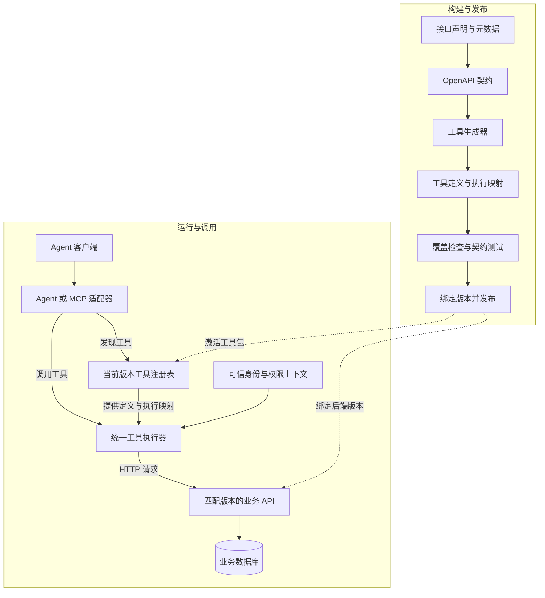
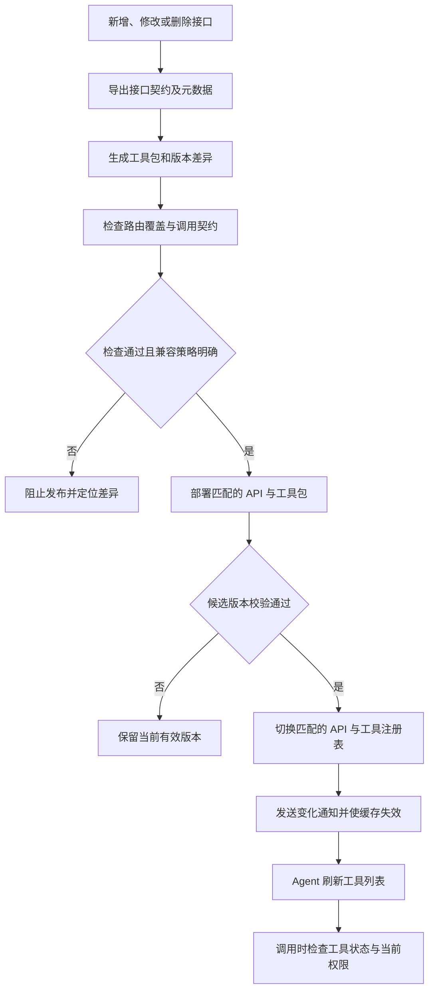

# API 契约驱动的 Agent 工具生成与同步方案

本方案面向需要把 HTTP API 提供给 Agent 调用的系统，建立由接口契约驱动的工具生成、执行和同步机制。每个纳入范围的接口操作对应一个基础工具；接口定义、工具描述与实际调用映射通过同一构建和发布流程保持一致。

核心设计是：维护一份接口定义，自动派生工具清单与执行映射，以覆盖检查、契约测试和版本绑定保证变更可追踪、可验证、可回滚。

## 1. 目标与适用范围

一个接口操作按 HTTP 方法与路径区分，例如 `GET /products` 与 `POST /products` 对应两个工具。一个 Agent 可以调用多个工具，工具数量与 Agent 数量相互独立。

首期覆盖带明确请求及响应模型的 JSON HTTP API。接口的新增、删除、参数调整、响应调整、权限调整和业务说明调整均纳入同步。业务数据库中普通记录的增删改查由接口执行，不触发工具重新生成。

系统中的全部接口都必须被识别并分类。纳入范围的业务接口全部生成工具；健康检查、认证回调等例外可通过显式排除声明说明原因。工具注册表保存完整工具目录，Agent 实际获得的工具集合再按调用者权限和任务需要确定。

**一致性要求**

- 每个纳入范围的接口恰好对应一个基础工具，每个工具均能解析到有效接口。
- 模型看到的输入结构与执行器采用的参数映射来自同一个工具包。
- 新增和修改随匹配版本发布；删除后不再发现该工具，旧调用得到明确失败。
- 参数或语义不兼容时，使用兼容层或新的工具版本。
- 工具发现权限与执行权限分别检查，调用时使用当前有效权限。

## 2. 总体架构

系统分为构建发布和运行调用两部分。构建阶段生成可复现的工具包，运行阶段加载已校验的版本并统一执行调用。下图表示逻辑职责，可以先部署在同一个项目中，再按规模拆分。

实线表示构建依赖或调用关系，虚线表示版本发布关系。业务结果沿调用链返回。



| 模块 | 主要职责 | 输出或状态 |
| --- | --- | --- |
| 契约导出器 | 从路由、类型模型和接口元数据导出标准契约 | OpenAPI 契约与实际路由清单 |
| 工具生成器 | 解析契约，生成输入输出结构及 HTTP 参数映射 | 工具包与版本差异报告 |
| 校验与发布流程 | 校验覆盖、兼容性和真实调用，并绑定发布版本 | 可追踪的发布记录 |
| 工具注册表 | 加载完整版本，提供工具发现与映射查询 | 不可变工具快照与当前版本指针 |
| 工具执行器 | 参数校验、授权、请求构造、调用、结果转换、审计 | 统一调用结果与执行记录 |
| Agent 适配器 | 对接具体 Agent 框架或 MCP | 工具发现和调用入口 |

一期使用构建产物与内存注册表即可。需要跨服务管理、发布历史查询或审计时，再引入相应的持久化存储。

## 3. 接口契约与维护入口

每个项目选择一个唯一维护入口。代码优先项目维护路由、请求响应类型和接口元数据，构建时导出 OpenAPI；契约优先项目维护 OpenAPI 及扩展声明，再生成接口骨架并验证实现。

`operationId` 在本方案中要求显式、唯一且稳定。工具内部标识由服务命名空间与 `operationId` 组合确定，例如 `catalog.get_product`，对外名称可生成为 `catalog_get_product`。名称转换需满足目标平台约束，并检测冲突。

OpenAPI 提供操作描述、参数、响应、认证声明和 `operationId`，并允许使用 `x-` 扩展属性承载额外元数据。本方案在此基础上增加工具暴露和执行行为声明。[OpenAPI 操作定义](https://spec.openapis.org/oas/v3.1.1.html#operation-object)、[OpenAPI 扩展机制](https://spec.openapis.org/oas/v3.1.1.html#specification-extensions)

| 定义内容 | 维护位置 | 在工具层的用途 |
| --- | --- | --- |
| 接口标识、方法、路径 | 原有接口声明 | 稳定标识与执行定位 |
| 路径参数、查询参数、请求体 | 原有类型模型或 Schema | 输入 Schema 与请求序列化 |
| 成功和错误响应 | 原有响应契约 | 输出 Schema 与错误映射 |
| 用途、参数含义、调用前提 | 原有接口说明 | 工具描述与使用提示 |
| 权限及认证规则 | 原有权限声明或统一策略引用 | 发现过滤与执行授权 |
| 是否暴露给 Agent | 接口附加元数据 | 工具覆盖检查 |
| 副作用与幂等语义 | 接口附加元数据 | 行为提示和重试策略 |

Agent 专用元数据可放在自定义 `x-agent` 扩展中，例如 `expose`、`effect` 和 `retryPolicy`。这些名称属于本方案的自定义约定。参数和权限规则从原定义导出，避免产生独立维护的副本。

工具行为不能仅凭 HTTP 方法推断。是否产生副作用、是否幂等以及重试条件应由接口明确声明。

## 4. 工具生成与执行映射

工具生成器执行契约校验、引用解析、操作规范化、平台格式转换和工具包生成。输出包含模型可见定义与执行器专用映射两部分。

模型可见定义包含名称、用途、输入 Schema、支持时的输出 Schema 及行为提示。执行映射包含服务标识、方法、路径模板、参数位置、序列化规则、响应转换和策略引用。后端地址由受控环境配置解析，Agent 只提交工具名称和业务参数。

默认输入按 `path`、`query`、`body` 分组；需要版本校验等业务请求头时，以明确的业务参数映射。凭据及可信身份从运行上下文注入。如下示例展示一个接口如何转换为工具：

```json
{
  "name": "catalog_get_product",
  "arguments": {
    "path": {
      "product_id": "p_123"
    },
    "query": {
      "include_stock": true
    }
  }
}
```

执行器据此构造 `GET /products/p_123?include_stock=true`。编码、参数校验和返回转换由统一适配逻辑完成。

生成器必须保留必填与可选、缺省与显式 null、枚举、嵌套结构、数组、分页及参数编码等语义。OpenAPI 与各模型支持的 Schema 子集可能不同，应为目标平台定义转换规则；无法保持接口语义的转换必须报错或配置专用适配器。

文件上传、二进制和流式接口在对应适配器完成前，必须在范围配置中明确列出。纳入范围但无法转换的接口阻止发布，不能静默跳过。

建议的产物为 `tools.manifest.json`，其至少记录：

- `sourceRevision`：规范化接口契约及相关元数据的摘要，涵盖所引用模型。
- `generatorVersion` 与 `targetProfile`：生成器版本和目标平台规则。
- `bundleDigest`：工具定义、映射和策略引用的完整产物摘要。
- `tools`：逐个操作的工具定义与执行映射。

发布记录使用 `releaseId` 绑定 API 构建标识和 `bundleDigest`。相同契约、生成器与目标规则必须得到相同产物。

## 5. 接口变更同步规则

| 变更 | 工具层处理 | 兼容性与发布要求 |
| --- | --- | --- |
| 新增接口 | 自动生成定义和执行映射 | 通过覆盖与调用检查后发布 |
| 新增可选参数 | 更新输入结构与参数映射 | 检查默认行为和序列化兼容性 |
| 新增必填参数或修改类型 | 更新定义并识别破坏性变化 | 提供兼容层或新工具版本 |
| 修改返回结构 | 更新输出结构和结果映射 | 分别检查旧调用方及新工具校验器的兼容性 |
| 修改路径或方法 | 更新执行映射 | 业务语义兼容时保留工具名称 |
| 修改权限或用途 | 更新策略引用、描述及相关缓存 | 权限变更在调用时执行，语义变更纳入评审 |
| 删除接口 | 移除可发现工具并撤销执行映射 | 旧调用明确失败；兼容期需保留可运行的旧接口 |
| 查询工具目录 | 读取当前生效快照并按权限过滤 | 保证一次完整分页查询使用一致快照 |
| 修改业务记录 | 调用既有工具完成操作 | 无需重新生成工具定义 |

结构与显式元数据可以自动同步。业务语义需要开发者随接口变更更新，例如“取消订单”调整为“取消并退款”时，即使参数未变，也必须更新描述、副作用声明与验证用例。

## 6. 自动同步流程



每次接口变更触发重新导出与生成，并与上一发布版本比较。差异报告覆盖新增、删除、参数变化、返回变化、说明变化和策略变化。

候选工具包只在覆盖与契约检查通过后进入部署。部署阶段验证匹配的 API 和工具包，验证失败时保持当前有效版本；验证成功后再激活新版本并通知客户端刷新。

开发环境可以通过文件变化监听自动重新生成。生产环境采用受控发布，使每次生效的工具集合都对应可追踪的构建结果。

## 7. 运行调用与权限

一次调用按照以下顺序执行：

1. 适配器接收工具名称和参数，执行器读取一个不可变工具快照。
2. 检查工具状态、参数结构和版本兼容性。
3. 基于可信上下文检查调用者及租户权限，取得适用于目标 API 的凭据。
4. 按执行映射构造 HTTP 请求，调用匹配版本的 API。
5. 原有 API 执行鉴权、数据权限、业务校验与事务。
6. 将结果转换成工具输出，并记录调用链标识、操作标识、版本、耗时和结果类别。

工具列表过滤用于控制可见性；每次执行仍需重新授权。请求中的业务资源标识也必须由 API 检查访问权限。模型可见的行为提示不能替代服务端策略。

采用 MCP 网关时，网关认证与下游 API 授权需要分别处理。应校验网关令牌受众，并通过下游授权或令牌交换取得适用于目标服务的凭据。[MCP 授权安全说明](https://modelcontextprotocol.io/docs/2026-07-28/tutorials/security/security_best_practices#token-passthrough)

返回结果保留业务错误码、可读说明和调用链标识。工具内部的“已下线”“参数不匹配”“无权限”“调用结果未知”等分类，由协议适配层转换成对应格式。

只对接口契约明确允许且符合条件的请求进行自动重试。写入请求发生超时时，若无法确认是否已执行，应返回结果未知状态；具备幂等机制时才按约定重试。列表和大结果保留分页能力并控制单次输出大小。

## 8. 发布版本与缓存一致性

API 和工具包作为同一发布单元管理。单体部署可随同一构建发布；独立部署时，先准备匹配的后端版本与工具快照，再让调用入口切换到该组合。滚动发布期间，各工具版本必须被路由到兼容的后端实例。

工具注册表使用不可变快照和当前版本指针。一次目录分页或工具解析绑定同一个快照，避免读到混合版本；权限与紧急下线状态仍按当前策略检查。常规下线允许已进入 API 的请求按约定完成，下线后不接受新的调用。

自有 Agent 在每轮任务开始前检查工具版本，并把使用的快照标识保存在运行上下文中。版本变化时重新加载，分页游标也绑定快照和权限上下文。跨轮或长任务不能假定首次加载的权限与工具状态一直有效。

MCP 适配器提供 `tools/list` 和 `tools/call`。按客户端协商的协议版本，在支持时发送 `notifications/tools/list_changed`；具体通知及订阅方式遵循该版本规范。客户端也应在约定的缓存有效期或下一次任务开始时刷新。[MCP 工具发现与调用](https://modelcontextprotocol.io/specification/2026-07-28/server/tools)

第三方客户端不一定立即处理通知，标准工具调用也不能被假定自动携带本系统的快照版本。因此，破坏性变更使用新的工具名称或保留可运行的兼容版本，防止旧参数被静默解释为新行为。版本摘要属于系统自己的管理机制。

删除后可保留最小下线记录，以便对旧调用返回明确原因。缓存中的旧工具不能恢复执行权限。服务端能够保证当前注册表和执行映射一致；客户端何时展示新目录取决于其刷新机制。

回滚同时恢复兼容的 API 版本与工具包，并再次使目录缓存失效。身份权限撤销和紧急下线策略继续按当前策略执行。

## 9. 校验与验收

覆盖检查必须同时读取实际路由清单和导出的契约，避免把“未导出到 OpenAPI 的接口”当作不存在。目标集合应满足：

```text
全部实际接口 = 纳入生成范围的接口 ∪ 显式排除的接口
纳入生成范围的接口 ∩ 显式排除的接口 = 空集
纳入生成范围的接口与生成的基础工具一一对应
```

工具包内的来源摘要应能与绑定的 API 构建核验；启动时发现不匹配则不激活该候选版本。

| 验收场景 | 通过标准 |
| --- | --- |
| 新增接口 | 无需手写工具包装函数，发布后可发现并成功调用 |
| 修改参数 | 模型定义与 HTTP 映射同时变化，旧参数按兼容策略处理 |
| 删除接口 | 新目录无该工具，旧缓存调用被明确拒绝 |
| 修改返回结构 | 新输出按声明返回，不兼容变化被识别 |
| 路由漏导出 | 实际路由与契约覆盖检查失败 |
| 不支持的 Schema | 明确报出操作和字段，不静默丢弃约束 |
| 修改权限 | 低权限调用者无法通过旧列表继续执行 |
| API 与工具版本不匹配 | 候选版本不被激活或流量被拒绝 |
| 多实例发布与回滚 | 调用始终进入匹配版本，恢复后列表重新刷新 |
| 写入超时 | 不发生无依据的重复提交，返回明确的未知结果状态 |

契约测试在隔离环境验证参数传递、响应映射、授权失败和业务失败。运行时持续记录版本不匹配、无效工具调用、参数校验失败、后端错误与耗时，用于定位同步或接口质量问题。

## 10. 实施阶段

| 阶段 | 范围 | 交付物 |
| --- | --- | --- |
| 第一阶段 | 单服务 JSON API、一接口一工具、构建生成、基础版本绑定、下线与回滚 | 契约导出器、工具包、注册表、执行器、一种 Agent 适配器、CI 校验 |
| 第二阶段 | 多服务聚合、独立网关部署、多实例版本路由、MCP 客户端刷新 | 服务命名空间管理、发布记录、兼容版本管理、客户端同步机制 |
| 第三阶段 | 文件与流式接口、大结果优化、任务级组合工具 | 专用适配器、按需工具加载、组合工具契约 |

基础工具始终由接口派生。后续增加组合工具时，可以把多个基础工具组成业务任务，但组合工具需要自己的契约和测试，不纳入接口一对一覆盖关系。

第一阶段完成的标志是新增、修改、删除三个场景均能够端到端自动同步，并能展示对应版本、差异报告和调用验证结果。

## 11. 实现参考

第一阶段已在当前仓库落地：通用能力位于 [api_tools](api_tools/)，[agent_permissions](agent_permissions/) 为项目适配，覆盖 21 个业务操作。实际使用、发布步骤、适配器与边界见 [API Agent 工具说明](agent_permissions/docs/agent-tools.md)。
